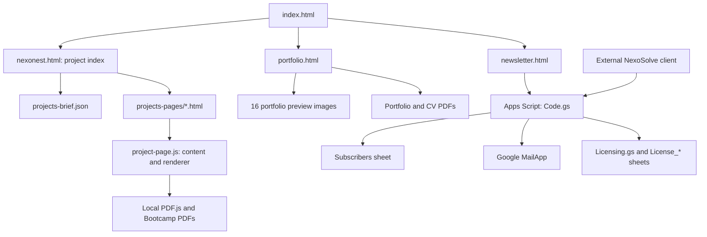

# NexoNest - Architecture and Developer Handoff

## NexoRhino 1.1.1 editor updates — 2026-10-29

The owner authorized Marketplace publication of both editor patches and this site
update. PyCharm 1.1.1 is approved and public on JetBrains Stable as update
1205943. Its downloaded ZIP passes all 220 canonical stub/marker, version and
license checks. All 230 archive entry payloads match the tested ZIP byte for byte.
The freshly packaged main-branch CI artifact also matches all submitted payloads,
including every JAR entry. Its range is 233–262.* (PyCharm 2023.3–2026.2.x), including
Community and Professional/unified editions. Twenty-three platform tests passed
in each of ten environments and the same ZIP passed every binary verifier. Three
Windows environments additionally cover Java 17/21/25. These are automated IDE
fixture results, not a new manual GUI or Rhino-host test claim. The uploaded ZIP
SHA-256 is 27ea3cdedee110cf58e724d29ce67f636fc54f0fba875d6010baebd1f84943f2.

VS Code 1.1.1 is now public and Stable on the existing nexonest.nexorhino
listing. The official Gallery API lists it with PreRelease=false. The VSIX
downloaded from that API's asset URL passes all 220 canonical stub/marker,
version and license checks. All 228 extension payloads match the tested VSIX byte
for byte. Its 23 ownership/activation tests pass. Runtime JS, icon and all bundled
stubs also match the tested public 1.1.0 payload; this is an editor metadata and
documentation patch, not a new VS Code compatibility range.
The unchanged minimum is VS Code 1.85 with Python and Pylance. Python remains
1.1.0 on PyPI; the editor versions are independent and no Python release is made.

The product page now confirms that both editor 1.1.1 updates are publicly
available, with their separate compatibility requirements and verified payloads.
The approval boundary was respected until JetBrains confirmed Approved; the
older PyCharm 1.1.0 retains its original 262.* range.
The hero uses the 1.1 family label rather than implying one shared patch version.
Existing product URLs, section IDs, geometry learning anchors, licenses and other
product pages remain unchanged. Source ownership is js/project-page.js; SEO HTML
and this guide's inventory/fingerprint are generated by the existing scripts.
The NexoRhino HTML entry point versions its renderer URL with ?v=20261029-editor-111-public. Browser QA found an older cached script replacing the freshly deployed SEO text with the earlier pending status; the page-local query forces a fresh renderer without changing other product pages or public page URLs. Update this key when changing this page's renderer content. The script tag is outside the generated SEO block.

The following sections preserve earlier publication checkpoints.

## NexoRhino public editor update — 2026-10-29

JetBrains update 1205557 / NexoRhino 1.1.0 is now approved and present in the
public update API. The downloaded public ZIP passes all 220 canonical stub,
version and license checks; every archive entry is byte-identical to the tested
local ZIP (ZIP container/compression metadata differs). This verifies the actual
public plugin payload, rather than inferring publication from its earlier upload.

Microsoft verification also finished: the official public Gallery API now lists
1.1.0 as the latest version. The public VSIX was downloaded from its returned asset
URL and passes all 220 canonical stub, version and license checks. All 228 files
under extension/ are byte-identical to the tested VSIX, including its runtime JS
and manifest. No CAPTCHA or publishing approval remains pending. PyPI 1.1.0
remains published and its downloaded wheel was independently installed and tested.

The product status now identifies version 1.1.0, the main links include its pinned
PyPI page, and release-1-1 records public availability on all three services.
Compatibility and the partial API scope remain explicit. Existing section
fragments, other product pages and runtime behavior are unchanged. Source ownership
remains js/project-page.js; SEO output is generated. The previous 2026-10-28
sections below record their historical checkpoints.

## NexoRhino editor acceptance and release preparation — 2026-10-28

The product guide now documents the native editor controls separately: PyCharm
Ctrl+Space / Ctrl+P / Ctrl+Q and VS Code Ctrl+Space / Ctrl+Shift+Space / Show or
Focus Hover (Ctrl+K, Ctrl+I). VS Code exposes the exact live lesson through the
Pylance Learn more URL; its external-site Open prompt does not require changing
Trusted Domains. A trusted workspace is required for the extension to activate.
PyCharm 1.1 compatibility is explicitly limited to build 262 / 2026.2.x.

These instructions describe the 1.1 candidate tested from local packages. Store
submission and approval are separate from local acceptance and website publication;
do not advertise public 1.1 availability until each store confirms it. Existing
product IDs, page URLs, learning fragments, license terms and non-NexoRhino pages
are unchanged. Source ownership remains js/project-page.js, with generated HTML
owned by the SEO script. The owner authorized both Marketplace updates and separately confirmed PyPI
publication. JetBrains accepted the 1.1.0 ZIP in Stable (update 1205557) on
2026-10-28 and reports Under review. Initial upload checks found no problems;
manual approval is pending. VS Code upload is waiting on the human CAPTCHA,
and Python 1.1.0 is published on PyPI (GitHub release workflow 40752947154
completed successfully). The downloaded public wheel and source archive matched
their PyPI SHA-256 hashes; installing the public wheel and consumer type checks
passed. Seven stub files differ only in checkout newlines; the authoring repository
release guard now accepts only CRLF/LF differences while still rejecting content
changes. The appended release-1-1
section reports the availability boundary without claiming that every store
already serves 1.1.0. Existing numbered section fragments are preserved. Website update commit d97cd33fe517c4f2123cbfc256f46a7d80feeb76 was deployed by
GitHub Pages run 40755108206 (success). Live browser verification confirmed the
1.1 release-status section and updated VS Code shortcuts, with no horizontal
overflow. Store status remains independent: PyPI 1.1.0 is public, PyCharm update
1205557 is Under review, and the VS Code upload is waiting on its CAPTCHA. The
release-status section intentionally does not advertise universal 1.1 availability.

## NexoRhino clickable learning tags and expanded lessons — 2026-10-28

PyCharm Ctrl+Q now displays a dedicated NexoNest learning block directly below the
signature with an exact #Class.Member link, including static properties and
implicit constructors that have no docstring. The page retains its stable class
and member fragments; method headings now identify their owning class explicitly.

The expanded reference adds 25 shared concept tutorials and 14 worked numerical
explanations with use cases, ordered calculations, common mistakes, and related
lesson links. The existing 182 authored short notes and 16 executable examples
remain. Members without individual worked lessons show an API summary followed
by labelled class/concept learning context, including the represented base-class
topic where appropriate. These are distinct content levels, not a claim that
all 2,583 member groups have individual authored worked examples.

Source ownership additionally includes NexoDesignSuite/RhinoPy/tools/
geometry-learning-topics.json. The builder renders all three website files;
never edit their generated copies directly. Concept links use stable #topic-name
fragments. Navigation opens the concept disclosure, scrolls to it, and focuses it;
related member links retain the existing exact-fragment behavior.

The page contains a deterministic nexorhino-learning-revision metadata value
computed from the authored notes/topics. The package release guard checks this
revision as well as anchor coverage; an old page with matching IDs cannot pass
as the new learning content. This is a freshness contract, not a deployment ID. The
reference CSS/JS URLs also carry a deterministic asset fingerprint so returning
visitors load the matching navigation and layout immediately after publication.

Pre-publication verification: 23 PyCharm platform tests and the native Ctrl+Q tag display
passed; six education/reference tests passed. The browser verified exact member
focus, a related-member jump, and opening/focusing a concept lesson. No browser
console warnings/errors or page-level overflow at 320/390/1440 pixels. The public
page responded HTTP 200 but still contained the older learning content. This
follow-up was prepared locally. The owner explicitly authorized publication of
only these educational website changes on 2026-10-28. The approved scope is the
reference HTML/CSS/navigation, NexoRhino product copy and this guide. Package
publication is not authorized by that approval. Pre-publication reference, SEO,
source-inventory and whitespace checks passed; live deployment evidence is
verified separately after the publishing push.

Publication evidence: educational content commit dc8644143952e9fc674fdf1696f6ae562653dc37
was pushed to main and GitHub Pages run 40744799259 completed successfully on
2026-10-28. The public HTTPS reference passed the authored education-revision
check and all 2,788 class/member targets. This records website publication only;
no Python or editor package was published. The asset-fingerprint follow-up keeps
the same educational revision and prevents older cached navigation/layout from
being reused after an update.

## NexoRhino geometry learning reference — 2026-10-27

Added the standalone [Geometry learning reference](nexorhino/geometry.html).
All 205 represented public Geometry types have stable class fragments and tags;
2,583 declared member groups have exact targets. Overloads share one member
section. There are 182 authored short/extended lessons and 16 Rhino examples;
other entries retain their API-derived summaries, identified separately.
The product page links to the reference and three representative method lessons.
PyCharm setup now explains why an existing interpreter is needed for standard
types and resolved return annotations.

Source ownership: NexoDesignSuite/RhinoPy/tools/geometry-learning-notes.json owns
education, and generated Rhino stubs own the displayed signatures and API summaries.
NexoDesignSuite/RhinoPy/tools/learning_reference.py builds this site's three files:
nexorhino/geometry.html, css/nexorhino-learning.css, js/nexorhino-learning.js.
Do not edit those copies directly. Regenerate with:
`python <NexoDesignSuite>/RhinoPy/tools/learning_reference.py --site-root <NexoNest>`.
Use the same command with `--check` for freshness. Then run this repository's SEO
and guide generators/checks. The learning-page templates live beside that builder.

Fragment contract: `#Rhino.Geometry.Class` and `#Rhino.Geometry.Class.Member`,
case-sensitive and independent of display order. A fragment opens its owning
class, clears incompatible filters, scrolls to the exact target, and focuses it.
Search matches names and content; topic filters combine with search. All content
is static HTML, with native disclosure controls and direct links. JavaScript adds
filtering and precise fragment reveal; there is no fetch, router, analytics, or
new runtime dependency. CSS uses the existing site tokens and a mobile breakpoint.
Unknown or malformed fragments do not run code or change other sections.

The reference documents a partial Rhino 8.35 / Python view. It does not install
or run Rhino, and does not add educational hover to Rhino's native editor.
Publish this page before releasing packages that include its URLs. This entry
records a local implementation; it does not establish deployment or availability
on the public domain. Verification: the local reference passed exact member reveal/focus, search,
combined topic filtering and reset, unique-ID and console checks. No page-level
horizontal overflow at 320, 390 and 1440 pixels after a long-name wrapping fix.
All 2,788 class/member targets exist in the generated static HTML. Reference
freshness, SEO (26 pages), and guide inventory checks passed. The real PyCharm
1.1.0 sandbox showed the corrected Circle.ClosestParameter tuple and note; clicking
its link opened the exact public fragment. The public path returned 404 because
this new page has not been deployed. These checks do not establish publication.

## Climora product and guide — 2026-10-25

Added the development-preview product and user guide at [Climora](projects-pages/climora.html),
with catalogue ID p_climora, editorial ID climora and Products / Data Analytics / Windows Apps membership.
Content belongs to js/project-page.js; generated HTML, canonical URL and sitemap follow the existing SEO workflow.
The shared SVG logo uses an open C, hourly bands and a rising green sun; the same source is used by the desktop app.
No installer or public release is advertised. The page documents actual EPW inputs, percentile/manual scales,
project files, output, shortcuts and screening limitations. It makes no predicted energy or comfort claims.

Sections may now provide an optional lowercase hyphenated id. The renderer validates its syntax and emits it
in static and runtime HTML. Navigation preserves explicit IDs, retains section-N for existing sections and
restores an initial hash after rendering. This supports the app's fixed getting-started and methods Help links
without tying them to section order. Other product URLs, IDs and category memberships are preserved.

Verification: generated SEO (25 indexable pages, no stale output), guide, syntax and static help-anchor/catalogue checks passed locally.
No browser automation or desktop interaction is performed at the owner's request. The owner authorized
publication on 2026-10-25. Deployment and live Help acceptance must be verified separately from source generation.


## prinTerra archive - 2026-10-24

Reviewed the prinTerra content and shared ABM media renderer. The owner confirmed
his contribution as sustainability simulations and nozzle control, and confirmed
a physical laboratory prototype followed by a financial halt. Prototype scope is
unspecified; do not infer a complete machine, successful print test or built camp.
The editorial page now distinguishes personal work, team outputs, simulations,
proposed capabilities and unverified historical estimates. The catalogue excerpt
follows this scope. Source authority remains `js/project-page.js`.

The supplied numbered PNGs 01-34 are packaged into
`assets/documents/printerra/printerra-project-book.pdf`: the cover stays single;
each subsequent spread is split left/right, preserving 67 original pages in order.
PNG 35 is blank and excluded. The image-based PDF preserves original text and
figures, including historical claims; it is not a revised technical report or a
searchable transcript. Two original MP4s are copied unchanged into
`assets/videos/printerra/`. Source masters stay outside this repository.

The prinTerra PDF preview is capped at 880px and uses a fixed 2:1 spread stage.
The square cover fits centrally within half the stage width, so turning from
the cover to a spread does not change frame height. Clicking any rendered page
retains the shared enlarged-page viewer. These CSS rules are scoped to prinTerra.

The existing ABM `projects` section provides lazy PDF loading, previous/next
spreads, enlarged pages, retry on failure and native local video controls. Its
optional `label` names the archive navigation; existing ABM defaults remain.
Direct PDF/video links in credits remain available without JavaScript and when
preview loading fails. No new dependency or route/ID migration. Rationale: reuse
the established document viewer instead of introducing a second slideshow system.
This is a local website update; no deployment or physical testing is implied.

Local verification: SEO and guide checks and JavaScript syntax passed. Headless
Edge verified PDF loading (67 pages), page turning, enlarged-page opening, both
MP4 metadata decodes, static archive links and no horizontal overflow at
1440/390/320px, with no page runtime errors. The rendered PDF spread was visually
inspected. Video metadata decoding does not prove uninterrupted full playback.

## NexoSolve Club installation route 2026-10-22

The NexoSolve product page now directs users to install the Grasshopper plugin through food4Rhino or Rhino Package Manager, place NexoSolve > Help > NexoSolve Club on the canvas, and click Download / Update NexoSolve to install the Windows app. The hero and closing links no longer expose the app ZIP, and the setup steps no longer describe manual extraction or an extracted App Path. The FAQ explains that installing the Grasshopper plugin alone does not install the Windows workspace. This supersedes earlier website guidance offering a direct ZIP download; the underlying distribution payload is unchanged. The owner requested Club as the sole user-facing Windows app installation route. Source authority remains js/project-page.js; generated HTML must stay synchronized. No product binary, server, pricing, license contract or route URL changes. This is a local content change, not a deployment or live Rhino installation check. A screenshot tutorial is not included in this change.


## Local research overview — 2026-10-20

Revision for local review: the overview now leads with one central claim, followed by an original SVG decision-flow diagram, a comparison table, a practical connection and a short under-review note. The diagram is an explanatory website asset, not a manuscript figure. A dedicated black/green line icon replaces the NexoNest mark in the editorial page and catalogue. Existing figure/table renderer contracts are reused; no new renderer or dependency. No publication authorized.

Added the `reframing-genericity` editorial entry and `projects-pages/reframingGenericity.html` using the existing renderer and catalogue. It is a short paraphrased conceptual overview, labelled **Manuscript under review**, with no full manuscript, manuscript figures, reviewer correspondence or publication/acceptance claim. The catalogue and portfolio link to the overview; renderer navigation and structured-data routes include it. The user requested local review only: these source changes are not published. Journal-specific sharing/anonymity conditions remain to check before deployment.

CurvAdapt's portfolio summary no longer implies publication; its editorial status also says the manuscript is under review and the plugin is in development. No product/research implementation or manuscript file changed.

Local verification passed: SEO and guide consistency checks, whitespace checks, desktop/mobile browser checks at 1440/390/320px, no horizontal overflow, static/no-JavaScript content, catalogue popup navigation, portfolio link and CurvAdapt sequential navigation. Existing portfolio loadProjectsData error remains outside this content change. Full-page review screenshots include offscreen content by overriding content-visibility during capture only.

## Owner management console - 2026-10-19 (deployed version 17)

The bound spreadsheet source adds **NexoNest Admin > Open management console**, with products, accounts, grants, vouchers, cohorts and registration review. Every server entry checks active/effective owner identity; no public admin route or broader permissions are added. NexoSolve keeps its existing storage/keys/contracts. Additional stable product IDs use separate ledgers/signing properties and cannot activate until configured. New cohorts use independent registration tables and rules; requests omitting courseId retain the original cohort and WORKSHOP_ENABLED gate. Record prices and consent are immutable once registrations exist. Shared-device account erasure preserves other accounts and device limits; batch erasure needs a fresh impact preview and typed confirmation. Panel review sends no email or certificate/license. Legacy editor mail actions remain separate. See [management runbook](integrations/google-apps-script/ADMIN.md).

The user explicitly approved saving and publishing this version. Google confirmed deployment version 17 on 2026-10-19, 7:08 PM, at the same endpoint with unchanged owner/access. The bound console loaded real owner aggregates and the legacy course. The initial automatic approval rejection was resolved before Google writes. Code.gs/PublicEmail/GameClubEmail/NewsletterDelivery and private properties were preserved. No real account deletion, grant/voucher issue, registration change or email was performed; mutation tests use mocked Google services. Version 16 remains the pre-console rollback, and saved-head sources must be restored separately for menu rollback.


This is the canonical guide to **this website repository**, not an implementation
guide to all the products it presents. Rhino plugins, simulation engines and
desktop clients described on the site generally live in other repositories.

Scope: all public pages, frontend modules, styles, data, media, local PDF viewer,
newsletter and licensing service sources, publishing configuration, legacy code,
known limitations, and contributor procedures. The generated appendices record
the exact source snapshot and every public project section.

**Evidence labels used here:**

- **Fact:** observed in the current checkout or an explicitly identified source.
- **Recorded decision:** supported by comments, existing documentation or the
  development conversation. It does not imply production verification.
- **Inferred rationale:** a technical interpretation of the implementation; the
  original author did not necessarily state this reason.
- **Recommendation:** a proposed future improvement, not current behavior.

Current working-tree changes are included. In particular, the Apps Script
licensing integration is present locally but was uncommitted at this review.
Remote settings, deployed versions, email delivery and external product maturity
have not been independently verified by this documentation pass.

## Contents

1. [Purpose and system boundary](#purpose-and-system-boundary)
2. [Repository layout](#repository-layout)
3. [Public pages and entry points](#public-pages-and-entry-points)
4. [Runtime and dependency model](#runtime-and-dependency-model)
5. [Project index](#project-index)
6. [Editorial project pages](#editorial-project-pages)
7. [Bootcamp documents and video](#bootcamp-documents-and-video)
8. [Portfolio and journey](#portfolio-and-journey)
9. [Newsletter frontend](#newsletter-frontend)
10. [Newsletter backend](#newsletter-backend)
11. [Licensing service](#licensing-service)
12. [Styles and shared UX](#styles-and-shared-ux)
13. [Assets and external services](#assets-and-external-services)
14. [SEO and hosting](#seo-and-hosting)
15. [Legacy and disconnected components](#legacy-and-disconnected-components)
16. [Decision register](#decision-register)
17. [Known risks and technical debt](#known-risks-and-technical-debt)
18. [Development and change recipes](#development-and-change-recipes)
19. [Verification and release](#verification-and-release)
20. [Documentation maintenance](#documentation-maintenance)
21. [Generated reference](#generated-reference)

## Purpose and system boundary

The website communicates a computational design and research practice: project
briefs, product pages, research evidence, education archives and a personal
academic portfolio. It is primarily a publishing application, not a cloud
simulation platform, plugin runtime, LMS or payment service.

The browser serves HTML/CSS/JavaScript and repository assets. The optional backend
is a separate Google Apps Script web app backed by Google Sheets and MailApp.
The locally present licensing API serves the external NexoSolve desktop product;
there is no website login UI or browser license client in this repository.



No part of the diagram implies a currently deployed or functioning remote
service. Read the relevant implementation and deployment status separately.

## Archicast podcast

The Persian season introduction and narrator byline use the author's approved
first-person copy (updated and reviewed on 2026-10-19). The English introduction
remains in third person; this copy edit does not change episode summaries or audio.

Added locally on 2026-10-19 at the author's request. The Persian name is حسین نظری;
the existing English spelling Hossein Nazari is retained. The author confirmed
season 1 episodes 1–3 are published; exact release dates were not supplied.

The main NexoNest filter includes **Archicast**, with the **Season 01 - Form**
subfilter and catalogue record `p_archicast_season_01`, titled **Archicast**.
The separate homepage podcast shortcut was removed at the author's request on
2026-10-19, preserving the two main entry routes, NexoNest and Portfolio.
Archicast remains accessible through the project index. The season is a standalone Persian RTL
page, with one Persian and one English paragraph for the season and each of the
three episodes. English blocks declare `lang="en"` and `dir="ltr"`. Local Vazirmatn
fonts and shared site color tokens keep it consistent without a new dependency.

The Archicast vault owns editorial content. Summaries were copied from its public
episode indexes; the season paragraph was adapted from its introduction. Only
approved public summaries and audio enter this site; no internal scripts, research
extracts or production notes are imported. There is no automatic vault exporter.

`css/podcast.css` owns layout; `js/podcast.js` pauses other tracks when one starts
and reveals an error message on media failure. Native audio controls and direct
file links work without JavaScript. Audio uses `preload="none"`, no autoplay,
and is copied unchanged into `assets/audio/archicast/season-01/episode-01..03.mp3`.
Source files were episode 1 `product/S1-E1.mp3`, episode 2 `S1-E2.mp3`, and episode 3
`Episode03_Season_01.mp3`. These copies require deliberate replacement if masters
change. Browser metadata yields durations of 767, 880 and 703 seconds, displayed as 12:47, 14:40 and 11:43. No date, transcript or unpublished episode is fabricated.

Decision: use static accessible season HTML instead of extending the product
renderer. The page remains readable and playable without a data fetch or JS;
the trade-off is manually maintained season content. The catalogue and guide
generator explicitly recognize its standalone route, preserving existing product
IDs and renderer contracts. Sitemap includes the season URL. Local implementation
does not establish deployment, public audio availability or hosting range support.

Local verification on 2026-10-19: `scripts/test-podcast-browser.cjs` passed in
headless Edge for desktop/mobile layout, no initial audio requests, three actual
MP3 metadata decodes, playback and mutual pause, episode anchors, Podcast/season
filters, popup navigation, absence of a homepage podcast shortcut, no-JavaScript content/native controls
and no page errors. Screenshots were visually inspected. Run with Playwright
available; `PLAYWRIGHT_CHANNEL=msedge` selects installed Edge. The test serves only
loopback content and blocks external requests. Its local range-serving fixture
does not prove production hosting range behavior. Exact audio-copy hashes were
checked against Archicast sources. Guide inventory checks and JS syntax checks
also passed; these claims concern local files, not a deployment.

Navigation labels now use **Archicast** in the main filter and season menu, replacing the generic Podcast label as requested by the author. The internal category ID remains `podcast` to preserve filtering contracts.

Navigation refinement on 2026-10-19: the catalogue title is **Archicast** and
the season subfilter is **Season 01 - Form**, at the author's request. The desktop
filter grid uses implicit columns instead of a fixed six-button count, keeping
all seven filters on one row. At 820px and below, the existing multirow grid is
retained for readable touch targets. IDs, routes and audio are unchanged.

## Workshop registration

The registration file is `CTworkshop01.html` for edition-specific management.
Its original Persian page title and hero heading are preserved. The catalogue
label is Computational Thinking Workshop 1. Catalogue ID `p_computational_thinking_workshop_1` links
to the renamed `CTworkshop01.html` URL under Events / Workshops and Education.
The custom SVG uses connected components and a highlighted edition number.
The index uses its normal brief popup and navigation, fixed visual ordering,
and a noscript link. This is a standalone registration page, so the guide
generator validates its explicit catalogue ID/route without an editorial record.
Adding catalogue visibility does not enable payments, submission or deployment.


`CTworkshop01.html`, `css/workshop.css`, and `js/workshop.js` provide the Persian RTL
registration page. Local Vazirmatn fonts avoid an external font dependency. The
page covers conditional student/newsletter fields, server-recomputed fees,
certificate selection, versioned consent, optional attributed website publication,
and a private receipt upload (JPEG/PNG/PDF, 5 MiB maximum).

The 2026-10-16 content revision sets workshop dates to 7–8 Aban 1405
(2026-10-29/30), 17:00–21:00 Tehran; critique to 12 Aban (2026-11-03),
17:00–21:00; and final submission to 15 Aban (2026-11-06), with the exact
submission hour/channel still pending. Dates are visible on mobile as well.
The hero badges show 8 hours of training (the scheduled window includes breaks)
and 4 hours of critique. The inline SVG hero illustrates understanding, identifying relationships,
generation of valid alternatives, validated measurement, and interpretation/selection,
with a feedback loop. A five-card framework maps the same semantic labels to
technical models. The published rubric awards 20 points to each stage; stage 5
allocates 5 to reproducible execution, 8 to interpretation, and 7 to selection.
Correctness and boundary tests belong to both generation and measurement.
Observed relationships alone do not establish causation.
It uses the page palette without new runtime or image dependencies. The hidden
anti-spam field is clipped in place to avoid horizontal overflow in RTL layout.

The workshop support link opens https://t.me/Nexonest_admin for direct Telegram support.

Attendance certificates are electronic only and have no online verification.
Completion certificates require project submission and a score strictly above
70/100 plus at least 10/20 in every stage, and are eligible for online verification. Participants who do not submit
or score 70 or below, or below 10 in any stage, receive only attendance certification if they attended.
Attendance tracking and certificate issuance/verification are operational work,
not implemented by this form. No attendance percentage is defined here.
The rubric is published on the registration page before project work.
On 2026-10-16 local browser checks covered desktop and mobile rendering;
these do not establish deployment, real submission or email delivery. Private album inclusion
is separate from optional attributed website publication; declining publication
does not affect grading or certification. AI use itself is not penalized;
unexplained or unverified decisions reduce the relevant assessment score.
Consent version `2026-10-v3` is synchronized in browser and server validation;
deploy both together. Old-version requests fail validation and must reload.
The selected certificate enum and other registration contracts are preserved.
The local approval-email template now includes these dates. This revision does
not deploy the service, send mail, or implement certificate issuance.

`integrations/google-apps-script/Workshop.gs` is a dedicated module routed through
the existing `doPost` dispatcher with `service=workshop`; existing routes are
preserved. It targets the confirmed business-account spreadsheet and separate
`Workshop_Registrations` tab, never newsletter membership or licensing records.
The existing spreadsheet `onOpen` also adds a Persian workshop menu. Only the
active `nexonest.contact@gmail.com` user can run administrative actions.

The receipt folder belongs to the business account and has owner-only permissions
(connector readback). Deploy the Apps Script as that account, executing as owner.
`WORKSHOP_ENABLED` must equal `true` to accept new requests. The public page's
`workshop-endpoint` is deliberately empty until live acceptance: it shows a
Persian preparation notice, disables submit, and tells users not to pay yet.
No deployment or actual email delivery is established by local tests.
On 2026-10-15 the business-account `Workshop_Registrations` tab (31006) was
created with 24 Persian headers, RTL layout, frozen header, filter, and owner-only
edit protection. Header values/formats were verified by connector readback.
`node scripts/test-workshop.cjs` passed 20 mocked backend checks. JavaScript syntax
and guide checks passed. Browser visual QA remains blocked by the browser tool's
local-URL policy; no responsive-rendering or real submission claim is made.

Request UUIDs make retries idempotent. Upload MIME and magic bytes, form enums,
consents and lengths are validated on the server. The module limits total
registrations to 150 and daily new submissions to 30 as basic storage/mail abuse
containment; distributed abuse can still exhaust this cap. Add a verified
anti-bot challenge before broad public promotion. Formula-like sheet values are
escaped. Personal information is not stored in browser storage. Receipts remain
private. Mail records `unknown` before sending and `accepted` after MailApp
returns; neither proves inbox delivery. Unknown sends need manual inspection,
not blind retry. Owner approval is explicit, locked, and sends confirmation once.
Optional `WORKSHOP_VIDEO_URL` adds the preparatory video; missing video content
is stated honestly in the confirmation. Rejected requests receive no automatic
email. Refund/change policy has not been supplied.

See [workshop deployment notes](integrations/google-apps-script/Workshop-README.md)
for setup and acceptance. The page is linked from the NexoNest catalogue and remains noindexed until
launch. Publishing the site and deploying Apps Script are separate operations.

## Repository layout

| Location | Responsibility |
| --- | --- |
| Root HTML | Home, project index, portfolio, newsletter, CurvAdapt wiki, old template |
| `projects-pages/` | Sixteen project pages; generated initial content, metadata, body project ID |
| `licenses/` | Public NexoRhino software terms; separate from NexoSolve activation |
| `js/` | Shared UI, project index, editorial renderer, portfolio and old renderer |
| `css/` | Design tokens, reset/base, shared layout/components and page styles |
| `data/projects-brief.json` | Category taxonomy and short project index records |
| `data/projects-jsons/` | Two legacy rich project JSON records |
| `assets/icons/` | Product/project marks |
| `assets/images/` | Evidence figures, screenshots, team photos, certificates, portfolio previews |
| `assets/documents/` | Branded CV/portfolio and Bootcamp source/preview PDFs |
| `assets/videos/bootcamp/` | Local archived participant videos; not all used by current page |
| `assets/vendor/pdfjs/` | Pinned library, matching worker, Apache license and version note |
| `files/` | Academic portfolio and CV downloads currently linked by portfolio page |
| `integrations/google-apps-script/` | Deployment sources and backend operational documentation |
| `scripts/` | Documentation snapshot maintenance; no frontend build system |
| `tmp/` | Ignored scratch/verification artifacts; not a release or test contract |
| `tmp-gp8-extract/` | Extraction residue outside the ignored `tmp/`; not a public feature |
| `.idea/` | Ignored editor state |
| `CNAME`, `robots.txt`, `sitemap.xml` | Domain/crawler configuration |
| `README.md`, `AGENTS.md`, this guide | Entry point, contributor rules, full handoff |
| `README.txt` | Original one-line readme; not the full handoff |

The generated file inventory lists exact files. Hidden Git/editor internals and
scratch directories are excluded from the maintained application snapshot.

## Public pages and entry points

| Page | Runtime and content owner | Important boundary |
| --- | --- | --- |
| [Home](index.html) | Static HTML, `home.css`, shared `ux.js` | Personal overview and navigation; inline Person structured data |
| [Project index](nexonest.html) | Six index modules and brief JSON | Filters and project popup, then real page navigation |
| [Portfolio](portfolio.html) | HTML plus `portfolio.js`, deferred `journey.js` | Independent personal content; not populated from brief JSON |
| [Newsletter](newsletter.html) | HTML form plus `newsletter.js` | Makes real backend submissions if used normally |
| [CurvAdapt wiki](curvadapt-wiki.html) | Static HTML and dedicated CSS | A planned learning path, not a complete generated documentation portal |
| [NexoRhino terms](licenses/nexorhino.html) | Static legal content and project navigation | Proprietary terms/attribution; not the licensing API |
| [Old template](project-template.html) | Static sample content and project navigation | Demonstrates old content blocks; not the active shell generator |
| `projects-pages/*.html` | `body[data-project]` selects `PROJECT_PAGE_DATA` | Full mapping and sections in generated reference |

All current editorial project shells load `project-page.js`,
`project-navigation.js`, and `ux.js`. NexoRhino also loads `nexorhino.css`.
Do not infer that `design-suite.css` is active merely because its file exists.

## Runtime and dependency model

**Fact:** there is no frontend `package.json`, bundler, framework, server-side
rendering pipeline, database migration system or checked-in deployment workflow
in the reviewed checkout. JavaScript mostly uses classic scripts, IIFEs and
globals; PDF.js is dynamically imported as an ES module.

Serve the repository over HTTP rather than opening `file://` URLs: JSON requests,
module imports and workers depend on normal browser origin behavior. A local
server needs to send JavaScript MIME types for `.mjs`. Partial PDF loading also
depends on the server honoring byte range requests.

Script order is an application contract. The index loads:

```text
filter.js -> state.js -> data.js -> nav.js -> modal.js -> render.js
                                                     + deferred ux.js
```

Definitions are established in this order; DOMContentLoaded handlers then load
data and bind/render UI. Moving these scripts to `async` can break their globals.
The shared loader deduplicates requests only within one page's lifetime, not
across navigation to another page.

External runtime resources include Google Fonts, unpinned Lucide on the
portfolio, YouTube embeds and the configured Apps Script newsletter endpoint.
The Bootcamp PDF viewer uses local vendored files. Product repositories,
food4Rhino listings and social links are outgoing destinations, not backend
implementations in this checkout.

## Project index

Sources: [brief data](data/projects-brief.json), [data loader](js/data.js),
[filters](js/filter.js), [state](js/state.js), [navigation](js/nav.js),
[popup](js/modal.js), [rendering](js/render.js).

### Data contract

Custom education icons use exactly black `#000000` plus one site accent from
`css/tokens.css`: NexoNest green `#7fb7a8` or Portfolio blue `#88b3d4`.
The author's direction excludes red. External SVG image files embed the hex
values because page CSS variables do not cascade into them. Keep these values
aligned with the tokens when changing the palette. The CodeJunkYard hub uses
code brackets and a green module; session 00 pairs those brackets with a blue
four-cell voxel seed. Computational Thinking Workshop 1 uses connected problem,
decision and result shapes, with a black edition numeral on green. All three
retain their existing asset paths and use transparent 128-by-128 viewBoxes,
rounded strokes and no font dependencies. The previously added ABM and
sustainability icons also use the exact same black/accent palette. Reviewed
locally on 2026-10-19.

ABM Bootcamp and Sustainable Design Workshop use dedicated two-colour SVG icons
for index tiles, popup artwork and editorial page marks:
`assets/icons/abm-bootcamp.svg` depicts
connected agents in black/blue; `assets/icons/sustainable-design-workshop.svg`
combines a building outline and leaf in black/green. Both use a transparent
128-by-128 viewBox and rounded strokes to remain legible at tile size. These
replace text initials and the generic popup studio logo; catalogue IDs and
destinations are unchanged. Reviewed locally on 2026-10-19.

Top-level arrays are `categories`, `subcategories`, and `projects`.
Category fields are `id`, `label`; subcategories add `parent`, which references a
category ID. Project fields are `id`, `title`, `excerpt`, `url`, `icon`, `image`,
`categories[]`, and `subcategories[]`. IDs in this index normally start with
`p_`; they are distinct from editorial IDs such as `abm-bootcamp`.

Category IDs are `podcast`, `education`, `projects`, `products`, `events`, `publications`.
The `publications` category is labelled **Publications** in both the index filter
and catalogue metadata, making the published-work category explicit. The category
ID and project membership remain unchanged. Label consistency reviewed locally
on 2026-10-19; this does not establish deployment.
One project can belong to several categories/subcategories. A subcategory's
`parent` controls which filter group displays it.

Reviewed 2026-10-19: selecting Products now presents five product-type filters,
replacing the previous per-project chips. The author explicitly approved the
additional Developer Tools group because editor stubs are not runtime plugins.
This reuses the existing category/subcategory UI; no third navigation level or
new CSS is introduced. Product IDs, URLs and top-level memberships are unchanged.

| Product subcategory | Catalogue membership |
| --- | --- |
| Grasshopper Plugins (`grasshopper-plugins`) | NexoSolve, OctoMass, OctoLand, OctoCity |
| Rhino Plugins (`rhino-plugins`) | NexoBreak, CurvAdapt |
| Data Analytics (`data-analytics`) | OctoLand, OctoCity, TectoTrack |
| Windows Apps (`windows-apps`) | NexoSolve companion desktop |
| Developer Tools (`developer-tools`) | NexoRhino, NexoNest Design Suite |

Classification follows published platform/workflow descriptions, including
in-development products. Data Analytics describes analytical purpose, while
the other groups describe host or packaging, so membership intentionally overlaps.
OctoCity remains explicitly concept-stage and CurvAdapt remains in development;
filter membership is not a release claim. GeoFactory remains in the Products
overview only: its archived concept has no confirmed runtime platform. TectoTrack
retains `sim-analysis` under Projects as well as its new analytics membership.
All ten products remain reachable from Products; choosing a group narrows them
with the existing dimming behavior. Selecting a different category or Clear
filter clears the subcategory normally. Old per-project product subcategory IDs
are removed from this local catalogue and are not public URL parameters.
Future products must use an evidence-supported group or remain overview-only.
Local `scripts/test-project-grid-browser.cjs` checks passed at widths 1440, 820,
390 and 320: five group labels, exact matching product sets, overlapping
memberships, ten-product overview, active-chip state, Clear filter, category
switch reset, retained Projects / Simulation and Analysis membership, and
Developer Tools popup labels. All 24 grid tiles retained stable positions with
no overlap or out-of-bounds tiles. These are local browser results, not deployment.

`loadProjectsData()` fetches JSON using `cache: 'no-store'`, caches its promise and
stores the result as `window.projectsData`. Failure is logged and resolves to an
empty data object. It does not retry automatically during that page lifetime.

### Interaction and ownership

1. `render.js` builds button icons using a fixed visual ordering, with alphabetical
   fallback for projects absent from that order. Text initials replace missing
   icons. Six decorative future-project placeholders follow the real projects
   in DOM order and are visually interspersed using sparse layout coordinates.
   `render.js` assigns stable wide/medium/small cell coordinates; `nexonest.css`
   uses 12, 6 or 4 columns with deliberate empty cells. Extra catalogue entries
   fall back to automatic grid placement. Filtering preserves each tile's cell.
   Local Edge checks on 2026-10-19 covered 1440x900, 820x900, 390x844 and 320x568:
   24 tiles including six future slots, no overlap or horizontal overflow,
   and stable positions within the grid after filtering. The narrow mobile
   index retains normal document scrolling to keep tiles readable.
2. `state.js` owns `activeCategory`, `activeSubcategory`, `activeProject` and
   exports state setters. UI updates rebuild subfilter chips, apply filters and
   update pressed/active states. `activeProject` is a state field; the popup also
   maintains its own current project.
3. `filter.js` normalizes labels/IDs and singular/plural aliases. Subcategory
   selection takes precedence over category selection. Nonmatches are dimmed,
   marked aria-disabled and removed from keyboard tab order, rather than deleted.
4. `nav.js` delegates clicks. A category click clears the subcategory; selecting a
   subcategory selects its parent category. Empty-space clicks clear filters.
   Project clicks request the popup. Circle navigation has an 850 ms animation.
5. `modal.js` owns popup visibility, scroll locking, fallback imagery, SVG logo
   fitting, focus placement/return, Escape handling and Tab focus wrapping.
   Opening the selected project's URL uses a full page navigation.

Popup artwork uses a centred frame capped at 320 CSS pixels on each axis.
`nexonest.css` fits the entire brief into the viewport with a grid: text and
actions retain their height while the artwork row takes the remaining space.
The card uses content height instead of reserving a fixed 760-pixel height,
removing excess blank space around artwork. Artwork height adapts between 48
and 280 pixels based on viewport height. The 108 local popup checks were rerun
successfully after this refinement on 2026-10-19.
The frame can become rectangular on short screens; preserving full copy and
avoiding scroll takes priority over a square. Short landscape viewports use
artwork beside the text. The card has no internal scrolling; opening the modal
also locks background scrolling. `components.css` positions the image inside
an explicit 80% by 80% inner box with `object-fit: contain`, preserving the full
artwork and equal 10% margins without intrinsic SVG sizing enlarging the grid
track and clipping the image. SVG and raster artwork share this sizing contract.
For new artwork, use a square canvas (recommended 1024 by 1024 pixels for raster
assets) with the subject centred and balanced internal whitespace; existing
non-square assets remain supported without cropping. Missing-image text remains
centred in the same frame. On 2026-10-19, `scripts/test-popup-browser.cjs`
passed local Edge checks for all 18 projects at 1440x900, 1366x768, 390x844,
360x640, 320x568 and 844x390 (108 combinations): image decoding, centred
contain sizing, positive frame dimensions, visible card/actions, no internal
overflow and background scroll locking. Workshop screenshots at 320x568 and
844x390 were also visually inspected. These checks do not establish deployment
or guarantee fit for arbitrary zoom, larger future copy or smaller viewports.

**Inferred rationale:** a shared JSON catalogue avoids duplicating filter
taxonomy in every index module, while keeping editing possible without a build.
The fixed shuffle is explicitly intended to keep a playful composition stable
between visits. This is a small catalogue, so repeated linear lookups are simple;
they would become inefficient for a much larger catalogue.

## Editorial project pages

Sources: [renderer and content](js/project-page.js),
[navigation](js/project-navigation.js), [styles](css/project.css).

### Content contract

`PROJECT_PAGE_DATA` is the active rich-content source. `PROJECT_PAGE_ORDER` is the
previous/next navigation order; the printed `page` label is a separate field.
Each HTML shell's `data-project` must match a key in the object.

Shared fields include `page`, `title`, `shortTitle`, `subtitle`, `icon`, `iconAlt`,
`eyebrow`, `lead`, `role`, `period`, `status`, `stack`, `tags`, `question`,
`response`, `proof`, `sections`, and optional `links` and `navGroups`. The active renderer escapes
visible editorial strings with `escapeHtml`; URLs still come from repository data.
This is source-authored content, not a validated arbitrary user-content CMS.

`renderProjectPage()` sets the title, English language, description and Open Graph
metadata; appends CreativeWork JSON-LD; populates the hero/sidebar/content/footer;
binds document/video controls; and dispatches `project:rendered`. Canonical/page
URLs also exist in HTML shells and hard-coded renderer mappings.

### Supported section kinds

| `kind` | Required content shape | Result |
| --- | --- | --- |
| `split` | `text[]`, `aside {label,text}` | Prose and margin note |
| `cards` | `items: [title,text][]` | Parallel feature/finding cards |
| `steps` | `items: [number,title,text][]` | Numbered workflow |
| `table` | `headers[]`, `rows[][]`, optional `note` | Data/programme table with an optional explanatory note |
| `columns` | `columns: {title,items:[title,items[]][]}[]` | Grouped curriculum |
| `projects` | `items: {code,title,people,pdf?,previewPdf?,video?}[]` | Bootcamp project selector/viewer |
| `archive` | `items: {code,title,status,description,href}[]` | Education archive links |
| `figure` | `image`, `alt`, `caption` | Evidence image |
| `figure-text` | Figure fields plus `text` | Evidence with explanation |
| `honesty` | `label`, `text` | Scope/maturity limitation |
| `credits` | `text`, optional `links`, optional `groups` | Attribution/links; groups contain `label` and `[name,role][]` people |

Every section also has `title`. Unknown kinds currently yield a heading with
empty body rather than a schema error. Adding a kind requires renderer, data,
styles, this table and verification changes.

### Navigation lifecycle

`project-navigation.js` builds the sidebar from `.content-section` titles and
assigns positional IDs `section-1`, `section-2`, etc. `data-nav-title` can override
the label. It rebuilds after DOMContentLoaded and `project:rendered`. In-page
navigation scrolls to sections and updates the hash; intersection observation
updates active links; scrolling drives `--project-scroll`.

The responsive sidebar toggles at the 1060 px condition, closes on selected links
or Escape, and updates `aria-expanded`. A page may map section titles to
`navGroups`; the renderer emits those group labels and the navigation renders
native collapsed `details` groups. Ungrouped pages retain the flat list. NexoSolve
uses Features, Getting started and About to keep its sidebar concise. Section
anchors remain positional, so reordering or inserting sections changes the
meaning of old section URLs.

### NexoSolve product page

[The NexoSolve page](projects-pages/nexoSolve.html) uses editorial ID
`nexosolve` and catalogue ID `p_nexosolve`, under Products / NexoSolve.
The shell, renderer URL mappings, previous/next order and sitemap include it.
Content and six selected PNG assets come from the external NexoSolve
`Documents/06 Presentation/Website Kit/`, checked against its Current State
and licensing notes on 2026-10-09. The site copy is maintained here; kit edits
do not automatically synchronize it. A 2026-10-10 redesign adds a benefit-card
section using the existing `cards` renderer and page-scoped CSS; no new runtime
or section kind is added. The page now presents case accounting, recovery,
local exports and compatible result reuse as user benefits. The image review
replaces the tall completion capture with the landscape saved-study screenshot,
removes the duplicate theme screenshot, and caps NexoSolve image display height
at 420 px on desktop and 320 px on narrow screens. The source PNGs are already
small; this is a presentation-size and image-selection change, not file-size
optimization. Six PNGs remain: the icon and five selected screenshots.

**Fact (2026-10-19):** the product page presents **0.0.4 Beta** as a standalone
Windows study workspace. The Grasshopper plugin is its connection layer; model
geometry, simulation and evaluation stay in the user's Grasshopper definition.
A local SVG connection diagram, using the existing figure renderer, shows both
process boundaries and the two-way input/result flow. Its full-height responsive
presentation preserves readable labels; the adjacent caption explains the flow.

The hero and closing CTA download the Windows app ZIP directly from
`https://raw.githubusercontent.com/Hossein-Nazari-Dev/NexoNest---Products/main/nexosolve/NexoSolve-Windows-x64.zip`.
This URL was read from the public product latest.json (0.0.4 Beta) and returned
HTTP 200 with Content-Type application/zip on 2026-10-19. It opens no GitHub page.
Project-link tuples may include an optional third value, the download filename;
the shared renderer gives those links a download attribute and no new-tab target.
Cross-origin download handling ultimately belongs to the browser and response
headers; this ZIP response is a binary download. Other links retain their existing
new-tab behavior. Static crawler-visible HTML is generated from the same renderer.

Installation copy names NexoSolve Club's **Download / Update NexoSolve** action,
keeps GHA, EXE and Samples together under
`%APPDATA%/Grasshopper/Libraries/NexoSolve-Portable-Windows-x64`, and distinguishes
app updates from Rhino Package Manager's plugin updates. The ZIP is the app;
the Grasshopper plugin is obtained separately. Version and diagram changes do
not establish native Rhino or scientific acceptance. Voucher pricing and manual
purchase terms are unchanged. Local browser checks at 1440 px and 390 px passed: both direct CTAs, loaded diagram, no horizontal overflow or runtime errors, and matching static content without JavaScript. Local page verification is separate from website
publication; this change does not publish the site or product binaries.

The sidebar groups NexoSolve sections under collapsed Features, Getting started
and About disclosures. This reduces the initial menu height while preserving
the existing section anchor links.

**Recorded decision:** reuse the editorial renderer and shared responsive
styles to preserve navigation and avoid a second page framework. Result reuse
requires compatible calculations and explicit revisions for external changes.
The public page describes finite Brute Force studies, local results, supported
Windows/Rhino requirements and bounded trial/offline access. Product runtime
and licensing acceptance remain owned by the external NexoSolve repository.

**Current local verification (2026-10-09):** browser checks passed at desktop
1280 px and mobile 390 px: all seven images loaded when their sections were
visited, no horizontal page overflow, mobile menu opened and closed on section
selection, and the index popup navigated to NexoSolve. The destination page
reported no browser console errors. JavaScript syntax, diff whitespace and the
guide freshness check passed. These checks do not establish live deployment or
the external product's Rhino/licensing acceptance.

## Bootcamp documents and video

The Bootcamp includes programme, curriculum, team, participant projects and
collaboration sections. Participants are selected by GP code. Only the active
project's detail DOM is present; GP03/GP12 are animation-only submissions.

### PDF lifecycle

`renderBootcampProject()` renders metadata, an **Open PDF** link to the original,
the viewer, and optional animation. `previewPdf` changes only the preview source.

`initPdfViewers()` transitions through `pending -> loading -> ready` or `error`:

- No PDF/library download until the viewer is within the IntersectionObserver
  margin of 200 px. Without that API it starts immediately.
- Dynamic import loads PDF.js **4.10.38** from `assets/vendor/pdfjs/`; worker must
  use the matching version. Failed imports reset the cached promise.
- `disableAutoFetch: true` and `disableStream: true` request on-demand range
  behavior. They do not guarantee small transfers on hosts without range support.
- Progress is shown when total size is known. A 60-second timer covers initial
  loading/rendering; it cancels the viewer and exposes Retry on timeout.
- The cover is page 1; subsequent spreads start at 2, 4, 6, etc. Last-page
  boundaries disable navigation. Rendering controls guard against overlap.
- ResizeObserver redraws after width changes with debounce. Canvas display fits
  the page width; single-page spreads occupy the full available width.
- Canvas clicks open a native zoom dialog. Zoom has separate navigation,
  cancellation and error feedback. Closing the dialog cancels active zoom work.
- Before switching projects, `disposePdf()` disconnects observers, clears timers,
  cancels render tasks and destroys PDF.js's loading task. Retry replaces the
  old viewer node to discard listeners and reinitializes it.

### Heavy source and preview separation

`GP09.pdf` is 74,197,147 bytes. `GP09-preview.pdf` is 9,417,175 bytes, with 18 pages
and matching page dimensions. The preview recompresses the existing image pages,
limiting image dimensions to 2880 px at JPEG quality 92. It is a lossy display
copy; the original remains the download target. Changing the source must also
regenerate and visually verify the preview.

**Recorded decision:** preserve original downloads, reduce preview cost, keep
PDF.js local to avoid CDN failure, defer work until relevant, and clean up when
switching projects. Lazy loading alone cannot fix an oversized PDF or blocked
library request.

HTTP video URLs become lazy iframe embeds. Non-HTTP video sources use native
video with metadata preloading. The active page largely references YouTube;
archived MP4s in the repository should not be mistaken for current embed URLs.

## Portfolio and journey

Sources: [portfolio page](portfolio.html), [application](js/portfolio.js),
[journey](js/journey.js), [portfolio styles](css/portfolio.css),
[style overrides](css/portfolio-v2.css).

Sections in navigation and document order: `profile`, `projects`, `publications`,
`experience`, `education`, `skills`, `myjourney`, `portfolio-pdf`. The last section
is labelled **Portfolio & CV**; `publications` is labelled **Research & Writing**.
All existing section IDs and project destinations are preserved. Personal copy is mostly in the
HTML; legacy project detail content also lives in `PortfolioApp` methods. It is
independent of the index catalogue and editorial project descriptions.

`PortfolioApp` initializes navigation, legacy project selection details, experience
role selection, PDF-image preview,
scroll indicator, smooth scrolling and tooltips. A second
hash-aware navigation IIFE controls active sections and emits
`portfolio:sectionchange`. Preserve this event when changing section navigation.
These two navigation layers overlap; consolidation would need regression checks.

### Local portfolio review — 2026-10-22

The portfolio tab favicon now uses `assets/portfolio-favicon.svg`, a dark H on
the existing pale background, instead of the profile photograph. This is scoped
to the portfolio tab; the profile portrait and social preview images are retained.


Reviewed the affected portfolio source and style sections on 2026-10-22. This is a
local review change; publication is not authorized. The owner requested the same
overall visual identity, no new factual content or claims, and links to existing
project pages instead of project thumbnails. The existing colors, monospace
family, sidebar, editorial rules and image-based document viewer are retained.

After owner review, Profile retains its original two-column Coordinates / Working
Thesis layout, followed by the visible interests and contact links. Selected-work
and CV-download shortcuts sit at the bottom, after those original blocks. The
profile paragraph size is restored; no disclosure elements hide its content. Projects and research
precede the longer background sections. Project headings and named action links
go directly to existing editorial pages; no new project images, metadata,
performance figures, authorship claims or publication claims are added. Research
status remains in the existing descriptions; missing metadata is not inferred.
Skill self-rating bars are removed and replaced with links to existing related
work. Body copy and project actions are modestly enlarged within the same theme.

The profile work shortcut uses the existing section-navigation event and hash
contract. `js/nav.js` is no longer loaded by the portfolio: its catalogue-data
initialization is unrelated to this standalone page and caused the missing
`loadProjectsData` runtime error. Native editorial, download, email and Overview
links need no catalogue initialization. Other pages still load their own shared
navigation as before. Existing document/image links retain their normal failure
behavior; this change does not add a new fetching or fallback layer.

Current local verification: desktop in-app browser screenshots of Profile, Projects
and Methods were inspected. The selected-work shortcut updates the active section
and hash; the TectoTrack action reaches the existing editorial page. Direct
`#skills` navigation worked in that check. Personal-details disclosure testing
was superseded when the original visible Profile structure was restored. The document viewer
initializes on selection. No browser errors were recorded in these checks. HTML
nesting, unique IDs, local link destinations, section anchors, JavaScript syntax,
whitespace and generated-guide consistency passed. Mobile viewport and full
accessibility acceptance were not performed in this change.

### Experience copy and layout — 2026-10-22

Reviewed the affected portfolio experience sources on 2026-10-22. Six existing
roles, organisations and date ranges are retained. Each role now has three
concise responsibility statements, paraphrased from the previous `getRoleData`
copy. General impact, publication and leadership claims are omitted rather than
expanded or inferred. The short section introduction summarises the same existing
areas of work. Links point to the existing NexoNest catalogue, TectoTrack,
prinTerra and bootcamp pages; no new project route or claim is introduced.

After owner review, Experience again uses the original two-panel interaction:
a role list on the left and a detail panel on the right at desktop widths. The
first role is selected immediately, with no empty placeholder. The panel includes
its existing date, role, organisation, three rewritten responsibilities and any
existing related-work link. Selected state persists across section switches.
Narrow layouts stack the selector above the panel. Native buttons support Enter
and Space; Up/Down, Home and End also select and focus a role.

Descriptions remain in `portfolio.html`, with no duplicated JavaScript role-data
map. The static page contains six readable articles and a hidden selector;
`setupExperienceSelection` progressively reveals the selector and hides inactive
articles. Without JavaScript, all descriptions remain readable. `aria-controls`
and `aria-pressed` expose the panel association and selected state. A selection
refreshes the existing scroll indicator. This supersedes the native-disclosure
layout reviewed earlier on the same day. Profile and other sections retain their
previously reviewed layouts. No publication is authorized.

Verification for this revision: JavaScript syntax, HTML nesting, unique IDs,
matching selector/panel associations, local links and guide consistency are
checked locally. Browser checks cover initial selection, switching roles,
keyboard selection and retained selection across section switches. Viewport
coverage is limited to the in-app browser's current size; full accessibility
acceptance is not claimed.

### Archive viewer is not the Bootcamp viewer

The portfolio uses **16 pre-rendered JPEGs**, not PDF.js. Its page path is
`assets/images/portfolio-preview/page-NN.jpg`. It initializes when Portfolio & CV is
selected and can preload during idle time from Research & Writing. It has cover/spread
navigation, an animated turn, keyboard arrows and an image lightbox with Escape
and focus return. `files/Portfolio_Academic.pdf` and `files/CV.pdf` are independent
download links. Regenerate the images and update `totalPages` when replacing the
portfolio PDF; replacing the PDF alone leaves the preview stale.

### Journey lifecycle

An inline loader in `portfolio.html` dynamically adds `js/journey.js` on entering
the journey section, or preloads it during idle time from Profile (1600 ms idle
timeout, 700 ms fallback). `journey.js` owns `MJ_ITEMS`, `MJ_SUMMARIES`, `MJ_QUOTES`,
selection state, timeline centering, fades/hints and the detail panel. It is a
separate narrative UI; editing the root portfolio HTML does not update this copy.

**Inferred rationale:** image previews provide predictable display for a fixed
portfolio without PDF parsing/worker overhead. Deferred journey loading reduces
startup work, with idle preloading to reduce later navigation delay. The trade-off is manual
synchronization of document images and duplicated personal content.

## Newsletter frontend

The project-index header labels its subscription link **Newsletter**, matching
the destination page title **NexoNest Newsletter** and making its purpose explicit.
The public route remains `newsletter.html`; this label change does not alter
subscription behavior or backend contracts. Reviewed locally on 2026-10-19;
deployment has not been verified.

Sources: [page](newsletter.html), [client](js/newsletter.js),
[styles](css/newsletter.css). The page's `newsletter-endpoint` meta tag contains
the public Apps Script `/exec` URL. This endpoint is public configuration, not a
secret; its presence does not establish which server version is deployed.

Payload fields: `fullName`, `email`, `occupation`, `organization`, `educationLevel`,
`fieldOfStudy`, `interests[]`, `currentExploration`, `consent`, `website`, `source`,
`submittedAt`. The occupation and field-of-study selects have conditional Other
inputs. `website` is a honeypot; an occupied field prevents normal submission.

Client validation checks required fields, email validity, education selection,
at least one interest and consent. It displays field/group errors and manages
submission/confirmation UI. A missing endpoint prevents submission.

POST uses a CORS-readable, URL-encoded payload containing JSON with a 30-second
browser timeout. Only a readable {ok:true,status} response with pending-confirmation
or already-subscribed opens the next-step panel. HTTP failures, unreadable responses,
invalid JSON, unknown statuses, and network/timeout failures keep all form values.
An uncertain result asks the reader to check their inbox before retrying; it does
not claim that nothing was submitted. The pending panel distinguishes MailApp
acceptance from recipient delivery. The page and email identity are NexoNest
Newsletter; the newsletter.html URL is retained to preserve links.

Decision: fail closed on unreadable responses instead of displaying success after
an opaque fetch. Live browser acceptance against the deployed Google endpoint is
still required: redirects/CORS depend on that deployment. Never restore no-cors
as a success fallback. A readable response is not proof of inbox delivery.

## Newsletter backend

Sources: [Code.gs](integrations/google-apps-script/Code.gs),
[module ownership](integrations/google-apps-script/MODULES.md) and
[deployment guide](integrations/google-apps-script/README.md).

The bound service uses Users, ProductSubscriptions, Newsletter and NexoBreak.
The older Subscribers/setupSheet implementation is historical and must not
replace these tables. Newsletter's 17-column order is a contract:

```text
ConsentId | UserId | EmailAtConsent | ConsentVersion | ConsentedAt | Status
UnsubscribedAt | Source | EducationLevel | FieldOfStudy | Occupation
Organization | Interests | CurrentExploration | Token | ConfirmedAt | SubmittedAt
```

`doPost()` routes `service=licensing` before the existing newsletter/Game Club
lock and dispatcher. Public payloads are limited to 12,000 characters; unknown
actions fail closed. Newsletter subscription validates consent/fields and returns
already-subscribed without sending to an existing subscriber. Pending retries retain
the original consent, demographics, token and seven-day expiry. Expired or cancelled
requests renew the existing row with a new consent ID/token rather than deleting it.
Formula-like user text is escaped before writing newsletter/user/profile cells.

PublicEmail.gs owns public email controls in the separate PublicEmailState sheet
(Key/JSON). Under the common script lock it reserves capacity before sending:
three requests per mailbox/purpose per rolling day (Gmail dot/plus aliases share limits), one-minute minimum spacing,
a shared public cap of 30 per rolling day (PUBLIC_EMAIL_DAILY_LIMIT), and a MailApp
quota reserve of 20 (NEWSLETTER_EMAIL_RESERVE). Failed or uncertain sends consume
an attempt; they are never automatically resent. The cap covers newsletter
confirmation and Game Club verification, not licensing OTP or workshop mail.
It bounds mail/storage abuse but does not replace edge rate limiting or CAPTCHA.
PublicEmailState contains mailbox hashes, rolling counters and hashed code state;
restrict spreadsheet access and include it in operational backups.

Game Club now requires mailbox verification for every join/restore. The client
first calls action=nexobreak_request_code with email, then nexobreak_join with
email, displayName, consent=true and the six-digit code. Codes expire after ten
minutes, allow five guesses, are single-use and stored only as hashes. Re-requesting
an unused valid code sends nothing and preserves it. Verification precedes all
user/product/score writes and token rotation. Existing bearer-token sync continues
unchanged; the response fields and score merging remain stable. A response lost
after consuming a code may require a fresh code. Client-controlled scores are not
authoritative competition results.

Security migration: old NexoBreak clients cannot join/restore without the code
flow. Update that external client before rolling out this server; do not provide
an email-only compatibility bypass. Existing sync tokens are neither invalidated
nor considered proof that an old session was originally issued securely. Recovery
rotates the token; compromised existing sessions require owner/user recovery.

Newsletter links use a consent-ID-bound HMAC with NEWSLETTER_TOKEN_SECRET, created
on first link issuance. Preserve/back up the secret: replacing it invalidates all
issued unsubscribe links. Confirmation and campaign emails include links in HTML
and plain text. GET only renders a confirmation form; POST with
action=newsletter_unsubscribe validates the signature under the lock, clears the
pending confirmation token, writes unsubscribed and UnsubscribedAt, and is
idempotent. No email address is put in the URL. Changing consent IDs on a fresh
signup invalidates older preference links. Existing confirmation links still work;
previously delivered campaign emails cannot gain unsubscribe links retroactively.
Campaigns only select subscribed rows, and desktop profile opt-in never overrides
an unsubscribed record. Product sign-in and workshop mail remain independent.
All mail uses send-only MailApp; no inbox access is needed.

### Campaign and shared quota

`sendNexoBreakAnnouncement()` is a manually run editor entry point using campaign
ID `nexobreak-1.0.0-food4rhino`. The NexoBreak 1.0.0 announcement links directly to its Food4Rhino product page and records batch counts. The current local implementation needs `Licensing.gs` for owner
checks and delivery records. It scans only subscribed newsletter rows, keeps the
`NEWSLETTER_EMAIL_RESERVE` (default 20), checks remaining quota before each send,
and stops after approximately five seconds excluding the final in-flight send. The
log distinguishes complete scans from time/quota stops and includes remaining
daily quota. There is no installed automatic schedule in this source.

`License_NewsletterDeliveries` records campaign/email hashes and `sending`, `sent`
or `review` states. Reservation happens before sending. Ambiguous records are
not automatically retried: Google email and Sheets cannot commit atomically.
Re-running a batch resumes unsent recipients; a new campaign needs a new ID.

Local code includes test-send entry points, but documentation or UI work does not
authorize using them. Subscriber exports and recipient-data transmission also
require explicit scope authorization. Never put subscriber rows in this guide.

### NexoBreak email presentation (2026-10-19)

**Fact, current source:** GameClubEmail.gs builds verification mail with NexoNest
and NexoBreak CID PNG logos, website colors, six selectable digits, expiry/security
copy and plain-text fallback. PublicEmail.gs delegates its MailApp message to this
required companion. New mail contains no scripts, tracking assets or Copy code
link. Users select the digits and paste into any plug-in code box. The owner
requested removal of the redirect after receiving the HTML test. The existing
Code.gs doGet stateless ?view=nexobreak-code helper remains only for links in
already-delivered mail. Its code stays in a URL fragment; the helper cannot read
accounts/sheets, send mail, renew codes or authenticate. Other product templates
and newsletter consent remain separate.

**Live evidence, separately authorized:** the existing shared service advanced
from version 12 to 13, then 14 under nexonest.contact@gmail.com, preserving URL,
execute-as identity and public access. Original companion modules were retained;
reviewed source was read back before deployment. The owner confirmed both test
emails, including branded HTML rendering; the second request returned HTTP 200
with verification-required. Version 15 removes the copy redirect at the owner's
request; source readback matched and deployment success was verified. No third
email, newsletter campaign or website publication occurred. NexoBreak product
version/channel remain 1.0.0 stable; native Rhino acceptance remains separate.

### NexoBreak product-page review (2026-10-19)

**Current source:** js/project-page.js remains the product-page owner. NexoBreak
keeps its existing shell URL, IDs, navigation and shared layout. Both download
CTAs now target https://www.food4rhino.com/en/app/nexobreak directly, replacing
the browse/search URL. Status is Stable / Free; no fixed latest-version claim is
made because Food4Rhino owns downloadable release details. Added concise install/
start steps and clarified subtasks, next-step notes, backup retention, viewport
activities, explicit focus resume and optional six-digit Game Club verification.
Core use needs no account; newsletter consent remains separate. Backup copy avoids
promising recovery or replacing normal saves. Existing product screenshots remain
historical illustrations and should be refreshed from current native UI later.

**Evidence boundary:** live NexoNest page and direct Food4Rhino listing were
opened on 2026-10-19; the live page still showed Beta and search links before this
edit. Local source/preview verification is separate from website deployment. No
website publication, subscriber operation or plugin release is performed here.

## Licensing service

### NexoSolve version 16 deployed - 2026-10-19

The prepared recovery/admission changes and 3/6/12-month issuance were published at 18:02 Tehran as Google version 16 on the same exec URL, owner and Anyone access. Only Licensing.gs, LicensingAdmin.gs and LicensingSheet.gs changed. Each normalized source hash matched the tested local copy after reloading; Code.gs remained unchanged and the workshop menu hook remains. Existing signing properties, shared modules and real user grants/vouchers were preserved. Version 15 is rollback. This supersedes earlier local-only recovery/short-term rollout notes.

The user-authorized smoke reused the existing synthetic guest device and passed RSA signature, unchanged trial end, bounded lease, signed profile defaults and anonymous profile rejection. No real email was sent; inbox delivery and authenticated redemption remain user acceptance. Source guide checks and local licensing/public-email/workshop mocks passed. No website/public binary upload, commit or push occurred.


Sources: [Licensing.gs](integrations/google-apps-script/Licensing.gs),
[LicensingProfile.gs](integrations/google-apps-script/LicensingProfile.gs),
[LicensingAdmin.gs](integrations/google-apps-script/LicensingAdmin.gs),
[NewsletterDelivery.gs](integrations/google-apps-script/NewsletterDelivery.gs),
[integration runbook](integrations/google-apps-script/LICENSING.md).

The product identifier is `nexosolve`; owner identity is
`nexonest.contact@gmail.com`. This is separate from NexoRhino's public terms.
Seven core service files, plus Workshop.gs for workshop registration, share one bound Apps Script project and the Code.gs dispatcher. PublicEmail.gs owns public mail limits, Game Club codes and newsletter unsubscribe. Licensing.gs owns authority/storage, LicensingProfile.gs owns name/consent, LicensingAdmin.gs owns owner-only operations, LicensingSheet.gs owns the generated AS_nexosolve view and NexoSolve Admin menu, and NewsletterDelivery.gs owns campaigns.

### Storage and request contract

`setupLicensing()` creates `License_Accounts`, `License_Devices`,
`License_Licenses`, `License_Vouchers`, `License_Sessions`, `License_LoginCodes`,
`License_Rates`, `License_Events`; newsletter deliveries are an additional table.
The generic storage functions use Key/JSON records with linear row lookup.

Configuration lives in Apps Script properties: `LICENSE_PRIVATE_KEY`,
`LICENSE_TOKEN_SECRET`, `NEWSLETTER_EMAIL_RESERVE`. No private signing key belongs
in the static site or desktop application. Setup creates the token secret if
needed; the private signing key must be supplied securely by the owner.

Requests select the service via `service=licensing`; payload is parsed from
`payload` or POST contents, limited to 8192 characters, and includes `product`,
`action`, `device` and action-specific fields such as `email`, `code`, `session`,
`voucher`. `device` must be a 64-character hexadecimal hash. Script locks guard
mutations; busy responses are retryable.

| Action | Behavior |
| --- | --- |
| `guest` | Register/find device and issue guest lease |
| `send_code` | Rate-limited email verification code |
| `verify_code` | Verify code, bind account/device, issue session and lease |
| `check` | Validate session/device and refresh entitlement lease |
| `profile` | Validate session/device, save display name and first newsletter choice, issue signed profile |
| `redeem` | Validate session/device, consume voucher, issue lease |
| `logout` | Revoke the presented session; keep trial/device history |

Success is `{ok:true,...result}`; failure is `{ok:false,code,error,retryable}`.
Leases return `payload` as an exact JSON string plus base64 RSA-SHA256 `signature`.
Payload fields: `schema`, `product`, `device`, `account`, `email`, `kind`, `allowed`,
`issuedAt`, `expiresAt`, `entitlementEndsAt`, plus additive schema-1 fields
`displayName`, `profileComplete`, `newsletterOptIn`. Old clients ignore the extra
fields; old leases default to an incomplete profile. Reformatting the JSON string before
signature verification changes its bytes and breaks the contract.

### Entitlement rules

- Guest trial: 14 days from the device's first server registration.
- Account trial: 90 days from that same registration, including guest time.
- One trial per email/device; one active device per account. Logout does not
  reset history or release the binding.
- Email codes: six digits, ten-minute expiry, five guesses; requests have
  per-email/device limits of five per rolling day and 60-second cooldowns.
  Gmail plus/dot aliases normalize to the same mailbox.
- Sessions: 180 days, revocable. Session/code/voucher secrets are hashed in
  storage rather than retained as raw bearer values.
- Deployed grants and vouchers support three/six/twelve calendar months (version 16) with month-end clamping. During a
  trial a voucher starts paid access immediately; it extends existing paid access.
  The consumed voucher row is the authoritative grant. Same-voucher retries do
  not add time again.
- Offline leases: at most seven days, never beyond entitlement expiry. Revocation
  is not immediate while a valid offline lease remains in use.
- Device transfer revokes sessions and waits until the last issued lease expires
  before binding a new device; access history and grant expiry are preserved.

Owner-only editor functions administer grants/vouchers, disabling, revocation
and transfer. They are not public API actions. Audit write failure is caught so
a committed voucher redemption does not become a reported failed request.

### Account onboarding

The external desktop uses email → code → name/unchecked optional newsletter
choice → account overview. Email remains identity; the display name is nonunique
presentation (2–80 characters). Existing accounts complete a missing profile once
without resetting trial history. Name edits do not change initial consent.
The authenticated profile action records the first consent choice once. Opt-in
uses the verified mailbox without a second email and preserves existing reader
demographics. Retries cannot resubscribe an opted-out reader, including an
interrupted account write. False does not remove an existing website subscription; an unsubscribed record is never reactivated by profile onboarding.
The signed choice is not the current newsletter delivery status.

The desktop shows signed names in its header and vouchers only after profile
completion. Its persistent 180-day session avoids routine OTP sends; a recent
verification permits immediate Run/Resume. A failed network check with valid
offline access is reused for one minute to avoid duplicate outage waits, while explicit/startup/background
checks still contact the service. These client behaviors and tests belong to
NexoSolve, not to this static website. Password authentication is deferred.

### Cross-repository boundary and deployment status

`LICENSING.md` describes desktop client build scripts, key generation, DPAPI
storage, access checks and mock tests in **NexoSolve**, not here. Paths such as
`scripts/New-LicenseKeys.ps1`, `scripts/Publish-Study.ps1`,
`scripts/Test-Study.ps1` and `tests/licensing/service.test.cjs` in that runbook are
external-repository instructions; they are absent from this website checkout.
Do not claim those desktop behaviors were validated by reading this repository.

Google version 6 was published on 2026-10-09 at 16:30, with the existing URL,
execute-as-owner account and Anyone access retained. NexoSolve records the UI
success screenshot and a live RSA/guest/trial/lease/profile-contract check that
sends no email. The user observed one successful email sign-in and running Rhino
study. Authenticated new profile, voucher, offline/expiry acceptance and public
package release remain separate checks. Version 5 is the immediate rollback;
version 4 predates licensing. Never delete tables during source rollback.

Keep all seven core .gs files and runbooks synchronized with NexoSolve. The external test loader must also include PublicEmail.gs; this repository does not update that external checkout. Preserve
endpoint, signing identity and original account/trial history. Setup alone sends
no mail; exercising `send_code` does. Local checks do not prove a static website
deployment or general product acceptance.

## Styles and shared UX

CSS loads in order; later files override earlier rules. Many selectors have
accumulated overrides, so the first occurrence is not necessarily effective.

| File | Role and usage |
| --- | --- |
| `tokens.css` | Colours, accent aliases, typography, spacing, dimensions and themes |
| `base.css` | Reset, body defaults, common container, reduced-motion rules |
| `layout.css` | Shared layout for index, portfolio and old template |
| `components.css` | Common navigation/project/icon/popup components |
| `home.css` | Landing page |
| `nexonest.css` | Catalogue composition, filters and responsive index |
| `project.css` | Editorial shell, content kinds, navigation, Bootcamp viewers/dialogs |
| `portfolio.css` | Original portfolio styling |
| `portfolio-v2.css` | Later portfolio overrides; order matters |
| `newsletter.css` | Form, conditional fields and confirmation panel |
| `curvadapt-wiki.css` | Wiki/learning roadmap |
| `nexorhino.css` | NexoRhino product and terms-specific styling |
| `design-suite.css` | Present but not referenced by current HTML |
| `ux.css` | Shared reveal/loading/motion effects |

`ux.js` scans images and selected content sections. Important/nearby images load
eagerly; others use native lazy loading and async decode. WeakSet tracking avoids
processing the same nodes twice. A MutationObserver scans injected content.
IntersectionObserver reveals sections; reduced-motion preference bypasses
reveal animation. Same-origin HTML links prefetch once on pointer/focus/touch
intent. There is no PDF-prefetch feature here.

Accessibility mechanisms include real buttons, alt text, labels, status regions,
pressed/expanded states, popup focus wrapping/return and Escape behavior. These
are implementation features, not proof of a complete accessibility audit.

## Assets and external services

Product icons and screenshots have separate roles: SVG logos fit within popups;
research figures support claims; certificates/team photos support biographies;
archive media belongs to education records. Do not reinterpret screenshot text
or archived assets as evidence of a current released product version.

`files/` and `assets/documents/` contain different CV/portfolio files. Follow actual
HTML link targets before replacing them; there is no automatic synchronization.
Likewise, pre-rendered portfolio JPGs and the portfolio PDF are separate assets.

Local PDF.js must retain its Apache license and notices. NexoRhino's proprietary
terms apply to that software and bundled stubs; they are not a repository-wide
open-source license declaration. No root license file establishes reuse terms
for every website asset in this checkout.

External dependencies can fail independently: font fallback is monospace;
Lucide icons rely on a CDN; YouTube relies on external availability; Apps Script
submission relies on that public deployment and its executing account's quota.
The PDF viewer intentionally does not rely on an external CDN.

## SEO and hosting

`CNAME` contains `nexonest.com`. `robots.txt` permits crawling and points to the
sitemap. HTML has titles, descriptions, canonical links and Open Graph fields;
editorial HTML includes CreativeWork structured data before JavaScript runs.
The browser updates that same identified record instead of appending a duplicate.

**Inference:** these files fit a static hosting setup such as GitHub Pages. The
repository does not prove the hosting provider, branch, deployment workflow,
HTTP headers or current published version. Do not switch hosting services based
only on `CNAME`.

Reviewed 2026-10-19: `node scripts/update-seo.cjs --write` generates initial
editorial content for all 16 project routes from the existing browser renderer's
data, pure rendering functions and content template. `js/project-page.js` remains
the content owner; generated HTML is not a second authoring source. The script
evaluates trusted repository JavaScript locally, never remote or user input.
It fails if the expected renderer boundary/root contract changes. Regenerate
after changing project data or its content template; no framework or hosting
migration is involved. Initial HTML contains the hero, project text, section
headings and links; JavaScript still enhances navigation, media and dialogs.
Interactive PDF/video controls need JavaScript; this is not a complete static
replacement for those features. Existing CSS and visual layouts are unchanged.

The same command synchronizes Open Graph/Twitter metadata from each page's
existing title and search description across 23 indexable pages, using existing
raster imagery (the author portrait replaces unsupported SVG social images).
It emits matching CreativeWork records and a deterministic sitemap containing
all those canonical routes, including both Code Junkyard pages and license terms.
Project runtime preserves the concise initial description and its OG equivalent.
Mixed-case filenames and public URLs remain unchanged. Social previews are
metadata only; no new artwork, rating, release date or product claim is invented.

`project-template.html` is explicitly `noindex, follow` and omitted from the
sitemap because it contains authoring placeholders. The workshop registration
page's pre-existing `noindex` remains intentional and it is also omitted; this
SEO change does not open registration or decide its publication readiness.
Run `node scripts/update-seo.cjs --check` before the guide refresh/check to detect
stale output, missing/duplicate search titles and descriptions, canonical
mismatches and missing social assets. The generator also synchronizes the existing
catalogue noscript directory with all 18 brief records, checks local destinations,
and escapes titles/URLs. This fixes the omitted NexoBreak and NexoSolve fallback
links without changing the JavaScript-enabled index or its popup interaction.

Local verification on 2026-10-19: `scripts/test-seo-browser.cjs` passed in headless
Edge for all 16 project routes with and without JavaScript: single matching H1,
matching lead/section counts, stable search descriptions and one matching
CreativeWork record after enhancement. Four representative pages at 1440px and
390px had no horizontal overflow; screenshots were inspected for the home,
mobile index and mobile portfolio. Tests block external network requests and
submit no forms. An existing Portfolio error, `window.loadProjectsData is not a
function`, remains: `portfolio.html` loads `nav.js` without `data.js`. The test
reports that known error separately and fails on unexpected errors. This finding
was recorded for the requested design review; it was not fixed by that SEO pass.
The local portfolio review on 2026-10-22 removes the unrelated script from this
page; deployment of that correction is not claimed.
Browser execution may need permission outside restricted Windows sandboxes.
Local checks do not establish production publication, indexing, rankings, Core
Web Vitals, rich-result eligibility or search traffic; Search Console and field
metrics were not connected. In the follow-up, Product Design was connected and
used for a screenshot-based audit of the published home → catalogue → project
brief → NexoBreak flow, plus mobile catalogue/filter states, using the in-app
browser. This was review only; no visual changes were made. Screenshots support
observations about discoverability, hierarchy and text legibility, not full
accessibility compliance or measured conversion effects.
Ahrefs authentication subsequently succeeded, but Site Audit projects, Site
Explorer metrics/domain rating and the public domain-rating endpoint all returned
`Insufficient plan`. No ranking, traffic, backlink or audit-health numbers were
retrieved; absence of data must not be reported as zero performance. Account
API entitlement is separate from connector authentication.

Robots allowing `/` is not protection for assets, source files, documents or
future admin material. Never publish secrets into the website tree.

## Legacy and disconnected components

`js/project-renderer.js` is an older `ProjectRenderer` implementation that loads
`data/projects-jsons/{id}.json`, accepting `?id=` or a filename-derived ID. It tries
several relative JSON paths and supports both `content_blocks` and `blocks`.
It renders old text/image/video/features/contributors/technical/technology blocks
and theme overrides, and emits `project:rendered`.

No current HTML references this script. `curvadapt.json` and `tectotrack.json`
therefore do not control the live editorial pages. The old renderer has duplicate
method definitions and slider stubs; it should not be treated as a second
production architecture to extend without an explicit reactivation/migration.

`project-template.html` has static example sections, not the same DOM/content
contract as the current small project shells. `design-suite.css`, `README.txt`
and `tmp-gp8-extract/` are also residue/older artifacts. Documenting them is not
authorization to delete them.

## Decision register

| Decision | Evidence and reason | Cost / condition for reconsideration |
| --- | --- | --- |
| Static HTML/CSS/JS, no framework build | Fact; inferred fit for a small publishing site and low deployment effort; SEO generator materializes editorial HTML before publishing | Globals and generated-content refresh; reconsider for substantially larger content/editor needs |
| Short catalogue separate from editorial content | Fact; inferred separation of index taxonomy from rich narratives | Same project titles/URLs can drift; synchronize on edits |
| Content kinds shared by project shells | Fact; inferred consistent layout with data-shaped authoring | Large `project-page.js` couples content and rendering; splitting is reasonable when edits become hard to review |
| Fixed catalogue shuffle | Source comment: playful composition without movement between visits | Order list must be maintained; omitted items use fallback sorting |
| Dim unmatched projects | Fact; inferred preservation of the whole visual catalogue | Aria-disabled is not a native disabled button; delegated mouse behavior still needs care |
| Rich editorial maturity/boundary sections | Fact; evidence-bounded claims in content | Do not replace prototype/concept labels with release claims without new evidence |
| Local PDF.js and lazy viewer | Recorded performance/resilience work | Vendor updates require paired worker/library and regression checks |
| Separate GP09 preview | Recorded response to 74 MB source | Lossy copy and regeneration work; preserve original |
| Portfolio JPEG preview | Fact; inferred simpler fixed-document preview | Images/count/download can drift |
| Apps Script + Sheets | Integration runbook: early-stage service | Linear scans, quota and concurrency limits; unsuitable as an unlimited scaling assumption |
| Email confirmation and readable results | Fact; confirmation proves email control; unreadable browser responses fail closed | Live CORS/redirect and real delivery require separate acceptance |
| Shared newsletter/license endpoint | Current code/runbook | Fewer deployments but coupled scripts, account quota and service reliability |
| Signed offline license lease | Code/runbook | Offline usability trades off immediate revocation; key rotation needs client coordination |
| Reserve campaign delivery before sending | Source comments/runbook: avoid duplicates on ambiguous sends | May skip an unsent recipient pending review; exactly-once delivery is not guaranteed |
| Single Obsidian-compatible handoff | User request in this chat | One portable document; generated facts help freshness but architecture prose requires human/agent review |

Historical intent not supported by evidence is deliberately labelled inference.

## Known risks and technical debt

1. Content duplicates across index JSON, project JS, portfolio HTML/JS, metadata,
   route maps, sitemap and document assets. There is no single global CMS source.
2. The filter normalization maps are cached on first use. Calling them before
   data exists can freeze empty maps; normal current flow waits for data, but a
   future startup refactor must preserve this sequencing.
3. Dimmed catalogue buttons are marked aria-disabled, but navigation delegates
   clicks without checking that flag. Do not assume filtering prevents all mouse
   activation of dimmed projects.
4. HTML interpolation and link schemes assume trusted repository content.
   `escapeHtml` is not URL validation or a complete user-content sanitizer.
5. Portfolio has overlapping navigation layers and old renderer/style residue.
   Avoid broad cleanup during a narrow feature change.
6. Newsletter requires a readable deployed endpoint response. CORS/redirect and
   real delivery acceptance remain unverified by local mocks. Public email caps
   contain abuse but a malicious caller can still exhaust the public allowance.
7. Honeypots/basic email-device limits are not robust public edge protection.
   Apps Script capacity and MailApp quota belong to the executing account.
8. Sheets writes across rows/tables are not transactions; locking reduces races
   but cannot atomically coordinate email and persistence or prevent all partial
   failures. Campaign review states and voucher idempotency are intentional.
9. Device hashes are pseudonymous, not anonymous or immutable hardware IDs.
   Desktop reinstall/registry/cloning limitations belong to the client runbook.
10. Large PDFs/MP4s increase repository and transfer costs. Range support is a
    host capability; canvas previews also have memory/CPU costs on weaker devices.
11. No standard repository-wide automated suite/build/CI was present before this
    doc task. Historical scratch tests are not a guaranteed maintained test suite.
12. External `lucide@latest` is unpinned; external font/video/listing availability
    is separate from website availability. Current documentation does not verify
    external links, quotas, release statuses or Google account configuration.

Recommendations: fix concrete drift when modifying its area; prefer consolidating
route/content ownership before introducing a framework or CMS solely for cleanup.

## Development and change recipes

### Run locally

From the repository root, with Python available:

```text
python -m http.server 8000 --bind 127.0.0.1
```

Open `http://127.0.0.1:8000/index.html`. A basic server can test full-download
fallback but may not support byte ranges. Do not submit the live newsletter form
as an incidental smoke test. No dependency installation is required for normal
website editing; Node is used for syntax/docs checks, not a frontend build.

### Add or edit a project

1. Add/update a brief record and valid taxonomy references in `projects-brief.json`.
2. Add/update its editorial object in `PROJECT_PAGE_DATA`; preserve factual maturity.
3. Add/update a shell using an existing current shell, with correct `data-project`,
   metadata, canonical URL and relative asset/script/style paths.
4. Update `PROJECT_PAGE_ORDER`, renderer URL maps and desired index visual order.
   Do not confuse catalogue ID, editorial ID, page label and filename.
5. Add assets with captions/alt text and outgoing product/research links as needed.
6. Run `node scripts/update-seo.cjs --write` to regenerate initial HTML, metadata
   and sitemap, then `node scripts/update-seo.cjs --check`. Update any affected
   portfolio references. Run the SEO browser check when changing the renderer.
7. Update this guide and generated reference; verify popup, page, navigation,
   responsive layout, metadata and local links.

### Change a section type

Update `renderSection`, its data shape, CSS, supported-kinds table and representative
browser cases. Existing serialized shapes/IDs should stay stable unless migration
is explicit. Compare desktop/mobile behavior and escaping/trusted-HTML boundaries.

### Replace a Bootcamp document

Update the original asset and item path; generate a lighter preview only if useful.
Keep `pdf` as the original and `previewPdf` as the optional display copy. Check all
pages visually, page count/dimensions, first/last spread, zoom, error, cancellation
and mobile resize. Check range behavior on the actual hosting service.

### Update personal portfolio

Find the source first: static HTML, role/project detail methods, journey data or
preview images. Update document downloads and all 16-page references together if
the document changes. Verify section/hash navigation and selection reset behavior.

### Change backend contracts

Update the matching frontend/client and both service source copies where relevant.
Use the integration runbooks for private configuration/deployment; never copy keys
into the site. Confirm the shared `doPost`, table schema, existing spreadsheet,
endpoint and signing key remain compatible. Use mocks by default; deployment,
live mail and license administration are separate explicitly authorized actions.

## Verification and release

2026-10-18 public-email changes are local source changes, not a deployment claim.
Run node scripts/test-public-email.cjs and node scripts/test-workshop.cjs for mocked
backend regressions. Run node scripts/test-newsletter-browser.cjs with Playwright
available in the development environment; PLAYWRIGHT_CHANNEL=msedge selects an
installed Edge when bundled Chromium is unavailable. The browser test substitutes
the endpoint and blocks external traffic. Neither test sends real mail.
Deploy PublicEmail.gs together with Code.gs, LicensingProfile.gs and the existing
core files, then publish the frontend with its updated script version. Keep the
same deployment URL, executing owner, signing identity and tables. Coordinate the
external NexoBreak code-entry UI first. Real email acceptance is a separate,
explicitly authorized operation; local tests do not authorize it.


### Local source checks

```powershell
Get-ChildItem js -Filter *.js | ForEach-Object { node --check $_.FullName }
Get-ChildItem integrations/google-apps-script -Filter *.gs | ForEach-Object {
    Get-Content -Raw $_.FullName | node --check
}
node --check assets/vendor/pdfjs/pdf.min.mjs
node --check assets/vendor/pdfjs/pdf.worker.min.mjs
node scripts/update-project-guide.cjs --check
git diff --check
```

Syntax checks do not execute browser features or Google services. The guide
checker validates generated coverage/fingerprint and local Markdown link targets;
it cannot validate architectural explanations, production behavior or remote URLs.

### Browser checks by area

| Area | Minimum meaningful verification |
| --- | --- |
| Index | All/category/subcategory counts, resets, popup keyboard/focus, asset fallback, project destination |
| Editorial | Every changed page/section kind, sidebar, previous/next URLs, metadata, mobile layout |
| Bootcamp | No PDF request before near visibility; local module/worker; all 10 PDFs; first/last spread; retry/timeout; rapid switching; zoom/close; resize; animation-only entries |
| Portfolio | Direct hash, back/forward, each section, role/project details, journey first/repeated open, all image spreads/lightbox/downloads |
| Newsletter | Mock transport, field/consent/Other validation, honeypot, pending/error/change-email; never accidental live delivery |
| Backend | Mock quota/locks/tables/mail/time; confirmation expiry/duplicates; license trial/device/code/session/voucher/lease/revocation cases |

Historical evidence: the 2026-10-03 local Bootcamp Playwright/Edge pass covered all
10 PDFs, blocked external requests, navigation boundaries, zoom, retry, timeout,
rapid switching, animation-only entries and desktop/mobile resize, with no
uncaught page errors. GP09 preview's 18 pages/dimensions and rendered appearance
were compared. This is a dated local result, not a new browser run or production
verification on 2026-10-09. `tmp/bootcamp-check.cjs`, if still available, is scratch
evidence with environment-specific browser assumptions, not a portable test runner.

### Publish/release boundary

Inspect repository/deployment settings before choosing the publish action; do not
invent a `deploy` command. Static publication and Apps Script version updates are
different deployments. Publish only authorized changes, preserving unrelated work.
After publication, verify public page/asset URLs, MIME types, range requests,
canonical metadata and viewer behavior on the real host. Confirm the backend
deployment version separately. No current doc check can certify publication.

## Documentation maintenance

This Markdown file is one portable Obsidian note: YAML properties, normal
headings, relative Markdown links, tables and Mermaid; no Obsidian plugins or
machine-specific absolute paths are required. With the repository as a vault,
source links resolve. When sharing only the document, its prose and generated
inventory remain readable; source links naturally need the accompanying files.

`AGENTS.md` requires every contributor/LLM change to update affected explanations
in the same change. `scripts/update-project-guide.cjs` refreshes deterministic
generated facts and checks them against the working tree, including source
content and asset bytes. This detects drift when the check runs.

Procedure:

1. Read the guide before editing and verify relevant claims against source.
2. Update prose, contracts, rationale, status and verification evidence for the
   actual change. Keep fact/inference/recommendation distinctions.
3. Set `reviewed` to the date the affected material was checked.
4. Run `node scripts/update-project-guide.cjs --write` to refresh the appendix.
5. Run `node scripts/update-project-guide.cjs --check` and inspect the diff.

Do not edit the generated block manually. Its fingerprint is a freshness signal,
not permission to refresh the appendix while leaving stale prose untouched.
No background monitoring or scheduler is installed: AGENTS instructions apply
to agent work; manual/external contributors must follow the same procedure.
Automatic realtime prose maintenance is not guaranteed by a Markdown file.

## Generated reference

<!-- generated-reference:start -->
### Source snapshot

SHA-256 of 204 application/configuration/integration/tool/asset files:

`aac215ebaa186714a143d7a719508c80f0c22b017228b2bdaeb5fafe311f4cd0`

Includes current working-tree bytes, including local backend changes and media.
Excludes this guide, root README/AGENTS, hidden internals and scratch directories.
This is a content fingerprint, not a Git commit or deployment identifier.

### Catalogue and editorial route map

| Catalogue ID | Editorial ID | Page | Categories / subcategories |
| --- | --- | --- | --- |
| p_climora | climora | [projects-pages/climora.html](projects-pages/climora.html) | products / data-analytics, windows-apps |
| p_archicast_season_01 | Standalone podcast season | [archicast/season-01.html](archicast/season-01.html) | podcast / archicast-season-01 |
| p_computational_thinking_workshop_1 | Standalone registration | [CTworkshop01.html](CTworkshop01.html) | events, education / workshop |
| p_nexosolve | nexosolve | [projects-pages/nexoSolve.html](projects-pages/nexoSolve.html) | products / grasshopper-plugins, windows-apps |
| p_nexorhino | nexorhino | [projects-pages/nexoRhino.html](projects-pages/nexoRhino.html) | products / developer-tools |
| p_design_suite | design-suite | [projects-pages/nexonestDesignSuite.html](projects-pages/nexonestDesignSuite.html) | products / developer-tools |
| p_nexobreak | nexobreak | [projects-pages/nexoBreak.html](projects-pages/nexoBreak.html) | products / rhino-plugins |
| p_octomass | octomass | [projects-pages/octoMass.html](projects-pages/octoMass.html) | products / grasshopper-plugins |
| p_octoland | octoland | [projects-pages/octoLand.html](projects-pages/octoLand.html) | products / grasshopper-plugins, data-analytics |
| p_octocity | octocity | [projects-pages/octoCity.html](projects-pages/octoCity.html) | products / grasshopper-plugins, data-analytics |
| p_curvadapt | curvadapt | [projects-pages/curvAdapt.html](projects-pages/curvAdapt.html) | products, publications / rhino-plugins |
| p_reframing_genericity | reframing-genericity | [projects-pages/reframingGenericity.html](projects-pages/reframingGenericity.html) | publications /  |
| p_geofactory | geofactory | [projects-pages/geoFactory.html](projects-pages/geoFactory.html) | products /  |
| p_printerra | printerra | [projects-pages/prinTerra.html](projects-pages/prinTerra.html) | projects / robot-io |
| p_alignment | building-alignment | [projects-pages/buildingAlignment.html](projects-pages/buildingAlignment.html) | publications, projects / sim-analysis |
| p_tectotrack | tectotrack | [projects-pages/techtoTrack.html](projects-pages/techtoTrack.html) | products, projects / sim-analysis, data-analytics |
| p_abm_bootcamp | abm-bootcamp | [projects-pages/abmBootcamp.html](projects-pages/abmBootcamp.html) | events / bootcamp |
| p_sustainable_development | sustainable-design | [projects-pages/sustainableDevelopment.html](projects-pages/sustainableDevelopment.html) | events, education / workshop, sustain |
| p_code_junkyard | code-junkyard | [projects-pages/codeJunkyard.html](projects-pages/codeJunkyard.html) | education / code-junkyard, programming, comp-geo |
| p_code_junkyard_session_00 | code-junkyard-session-00 | [projects-pages/codeJunkyardSession00.html](projects-pages/codeJunkyardSession00.html) | education / code-junkyard, programming, comp-geo |

Editorial navigation order: `climora` → `tectotrack` → `curvadapt` → `reframing-genericity` → `building-alignment` → `design-suite` → `nexobreak` → `nexosolve` → `octomass` → `octoland` → `octocity` → `geofactory` → `printerra` → `abm-bootcamp` → `sustainable-design` → `code-junkyard` → `code-junkyard-session-00` → `nexorhino`.

### Every editorial project and section

Statuses below quote the current website content; they are not independent product release checks.

#### Climora

Source key: `climora`; shell: [projects-pages/climora.html](projects-pages/climora.html); printed page label: `18`.

**Published content status:** Development preview.

**Purpose:** Climate evidence.<br>Design decisions.

**Role / period:** Product design & development / Hossein Nazari / 2026 — present.

**Stack:** Windows / Tauri / EPW weather data.

| Section | Renderer kind |
| --- | --- |
| A workspace around the evidence | `split` |
| Getting started | `steps` |
| Palette and legend | `table` |
| Project files and figure output | `cards` |
| Methods and limitations | `split` |
| Keyboard shortcuts | `table` |
| About Climora | `honesty` |

#### Reframing Genericity in Design

Source key: `reframing-genericity`; shell: [projects-pages/reframingGenericity.html](projects-pages/reframingGenericity.html); printed page label: `17`.

**Published content status:** Manuscript under review.

**Purpose:** Context, identity<br>and procedural universality

**Role / period:** Author / Hossein Nazari / Ongoing research.

**Stack:** Design theory / Computational reasoning.

| Section | Renderer kind |
| --- | --- |
| The argument at a glance | `figure` |
| What transfers, and what changes? | `table` |
| Why this matters to my practice | `split` |
| About the manuscript | `honesty` |

#### NexoSolve

Source key: `nexosolve`; shell: [projects-pages/nexoSolve.html](projects-pages/nexoSolve.html); printed page label: `16`.

**Published content status:** 0.0.4 Beta / Early access.

**Purpose:** Windows study workspace<br> connected to Grasshopper

**Role / period:** Product design & development / NexoNest / 2026 — present.

**Stack:** Windows x64 / Rhino 8.34+ / .NET 8.

| Section | Renderer kind |
| --- | --- |
| What you gain | `cards` |
| How NexoSolve connects to Grasshopper | `figure` |
| Your study workspace | `figure-text` |
| From definition to saved results | `steps` |
| Choose the values you actually need | `figure-text` |
| Review before you run | `figure-text` |
| Pause safely. Continue later. | `figure-text` |
| Reuse compatible results | `split` |
| Keep results on your computer | `figure-text` |
| Light and dark workspaces | `cards` |
| Requirements | `table` |
| Trial and licensing | `table` |
| Pricing | `table` |
| Account and offline access | `split` |
| Install the complete package | `steps` |
| Questions | `cards` |
| Early-access status | `honesty` |
| Get NexoSolve | `credits` |

#### NexoRhino

Source key: `nexorhino`; shell: [projects-pages/nexoRhino.html](projects-pages/nexoRhino.html); printed page label: `12`.

**Published content status:** Version 1.1 / Rhino 8.

**Purpose:** Rhino Python<br>editor assistance

**Role / period:** Hossein Nazari / NexoNest / 2026 — present.

**Stack:** Python stubs / VS Code / PyCharm.

| Section | Renderer kind |
| --- | --- |
| What NexoRhino provides | `cards` |
| Geometry learning reference | `credits` |
| VS Code installation | `steps` |
| PyCharm installation | `steps` |
| Stubs, not a runtime | `split` |
| Use and attribution | `credits` |
| Project links | `credits` |
| Version 1.1 release status | `credits` |

#### NexoBreak

Source key: `nexobreak`; shell: [projects-pages/nexoBreak.html](projects-pages/nexoBreak.html); printed page label: `13`.

**Published content status:** Stable / Free on Food4Rhino.

**Purpose:** Plan. Focus.<br>Recover.

**Role / period:** Product design & development / NexoNest / 2026 — present.

**Stack:** Rhino 8 / .NET 8 / Windows.

| Section | Renderer kind |
| --- | --- |
| A clearer design day | `split` |
| Dashboard inside Rhino | `figure-text` |
| Work loop | `steps` |
| Autosave-style versioned backups | `figure-text` |
| Core features | `cards` |
| Always within reach | `figure-text` |
| Breaks without losing context | `figure-text` |
| Daily report | `figure-text` |
| Local-first privacy | `cards` |
| Requirements | `table` |
| Install and start | `steps` |
| Download | `credits` |

#### TectoTrack

Source key: `tectotrack`; shell: [projects-pages/techtoTrack.html](projects-pages/techtoTrack.html); printed page label: `01`.

**Published content status:** Active development.

**Purpose:** Social digital twin<br>and crowd simulation

**Role / period:** Computational design & simulation development / 2023 — present.

**Stack:** Unity / C# / Python / BIM.

| Section | Renderer kind |
| --- | --- |
| System, not a scene | `split` |
| My contribution | `cards` |
| A behavioural loop | `steps` |
| Engineering underneath | `cards` |
| What it proves — and what it does not | `honesty` |
| Credits | `credits` |

#### CurvAdapt

Source key: `curvadapt`; shell: [projects-pages/curvAdapt.html](projects-pages/curvAdapt.html); printed page label: `02`.

**Published content status:** Manuscript under review / plugin in development.

**Purpose:** Reliable geometry<br>for simulation

**Role / period:** Concept, algorithms, analysis & development / 2024 — present.

**Stack:** RhinoCommon / C# / BPS.

| Section | Renderer kind |
| --- | --- |
| The weak link before simulation | `split` |
| Reliability workflow | `steps` |
| What the study found | `cards` |
| Method trace | `figure` |
| Evidence, not a magic threshold | `figure-text` |
| Current boundary | `honesty` |
| Research team | `credits` |

#### Building Alignment

Source key: `building-alignment`; shell: [projects-pages/buildingAlignment.html](projects-pages/buildingAlignment.html); printed page label: `03`.

**Published content status:** Research complete / manuscript development.

**Purpose:** Urban form<br>and energy demand

**Role / period:** Lead researcher & computational workflow / 2021 — 2024.

**Stack:** Grasshopper / Python / EnergyPlus.

| Section | Renderer kind |
| --- | --- |
| From visual order to measurable parameter | `split` |
| Experimental loop | `steps` |
| Method | `figure` |
| Findings | `cards` |
| Validation | `figure-text` |
| What followed | `honesty` |
| Research team | `credits` |

#### NexoNest Design Suite

Source key: `design-suite`; shell: [projects-pages/nexonestDesignSuite.html](projects-pages/nexonestDesignSuite.html); printed page label: `04`.

**Published content status:** Active development / private preview.

**Purpose:** Modern coding<br>for Rhino workflows

**Role / period:** Concept, architecture & development / 2025 — present.

**Stack:** Python stubs / C# metadata / IDE.

| Section | Renderer kind |
| --- | --- |
| Code outside. Run inside. | `split` |
| Two complementary tracks | `cards` |
| Trust requires verification | `steps` |
| What it enables | `cards` |
| Current boundary | `honesty` |

#### OctoMass

Source key: `octomass`; shell: [projects-pages/octoMass.html](projects-pages/octoMass.html); printed page label: `05`.

**Published content status:** Research prototype / evolving toolkit.

**Purpose:** Climate-aware<br>early form finding

**Role / period:** Founder, researcher & developer / 2021 — present.

**Stack:** Rhino / Grasshopper / climate data.

| Section | Renderer kind |
| --- | --- |
| Form already carries consequences | `split` |
| Working structure | `steps` |
| Research layers | `cards` |
| Not an automatic architect | `honesty` |
| Project credits | `credits` |

#### OctoLand

Source key: `octoland`; shell: [projects-pages/octoLand.html](projects-pages/octoLand.html); printed page label: `06`.

**Published content status:** Public legacy prototype.

**Purpose:** Terrain intelligence<br>for landscape design

**Role / period:** Concept & C# development / 2025.

**Stack:** C# / RhinoCommon / Grasshopper.

| Section | Renderer kind |
| --- | --- |
| Read the ground | `split` |
| Current capabilities | `cards` |
| Where it goes next | `honesty` |
| Repository | `credits` |

#### OctoCity

Source key: `octocity`; shell: [projects-pages/octoCity.html](projects-pages/octoCity.html); printed page label: `07`.

**Published content status:** Concept-stage system.

**Purpose:** Urban relationships<br>as design data

**Role / period:** Concept & research direction / In development.

**Stack:** Grasshopper / urban data / simulation.

| Section | Renderer kind |
| --- | --- |
| From objects to relationships | `split` |
| Research foundations | `cards` |
| What exists today | `honesty` |

#### GeoFactory

Source key: `geofactory`; shell: [projects-pages/geoFactory.html](projects-pages/geoFactory.html); printed page label: `08`.

**Published content status:** Archived concept / no public build.

**Purpose:** Geometry preparation<br>for fabrication

**Role / period:** Concept development / Exploratory.

**Stack:** Computational geometry / fabrication.

| Section | Renderer kind |
| --- | --- |
| The missing middle | `split` |
| Proposed workflow | `steps` |
| What survives | `honesty` |

#### prinTerra

Source key: `printerra`; shell: [projects-pages/prinTerra.html](projects-pages/prinTerra.html); printed page label: `09`.

**Published content status:** Laboratory prototype built / development halted.

**Purpose:** Earth construction<br>with a mobile robot

**Role / period:** Sustainability simulations & nozzle control / Spring 2023.

**Stack:** Rhino / Grasshopper / Kangaroo / Ladybug Tools / ClimateStudio.

| Section | Renderer kind |
| --- | --- |
| Project and contribution | `split` |
| Robot, form and toolpath | `steps` |
| Sustainability studies | `cards` |
| Project book and animations | `projects` |
| Evidence and development status | `honesty` |
| Team and archive | `credits` |

#### ABM Bootcamp

Source key: `abm-bootcamp`; shell: [projects-pages/abmBootcamp.html](projects-pages/abmBootcamp.html); printed page label: `10`.

**Published content status:** Completed programme.

**Purpose:** Teaching behaviour<br>through simulation

**Role / period:** Lead planner, instructor & mentor / 2023 — 2024 archive.

**Stack:** Rhino / Grasshopper / Python.

| Section | Renderer kind |
| --- | --- |
| Learning by building | `split` |
| Programme arc | `steps` |
| What participants practised | `cards` |
| Six-day programme | `table` |
| Curriculum structure | `columns` |
| Teaching team | `credits` |
| Participant projects | `projects` |
| Collaboration | `credits` |

#### Sustainable Design Workshop

Source key: `sustainable-design`; shell: [projects-pages/sustainableDevelopment.html](projects-pages/sustainableDevelopment.html); printed page label: `11`.

**Published content status:** Completed workshop / reusable curriculum.

**Purpose:** A wider view<br>of performance

**Role / period:** Programme development & instruction / NexoNest education archive.

**Stack:** Climate / systems / design methods.

| Section | Renderer kind |
| --- | --- |
| Sustainability is a relationship | `split` |
| Curriculum structure | `cards` |
| Learning loop | `steps` |
| Archive note | `honesty` |

#### CodeJunkYard

Source key: `code-junkyard`; shell: [projects-pages/codeJunkyard.html](projects-pages/codeJunkyard.html); printed page label: `CJ`.

**Published content status:** Archive scaffold / sessions in progress.

**Purpose:** Course archive<br>and lesson index

**Role / period:** Course design & instruction / NexoNest education archive.

**Stack:** Rhino / Grasshopper / Python / NexoRhino.

| Section | Renderer kind |
| --- | --- |
| Project structure | `steps` |
| Archive | `archive` |
| Why the archive matters | `split` |

#### CJY-Session-00

Source key: `code-junkyard-session-00`; shell: [projects-pages/codeJunkyardSession00.html](projects-pages/codeJunkyardSession00.html); printed page label: `S-00`.

**Published content status:** Placeholder / video coming.

**Purpose:** Setup and first<br>voxel test

**Role / period:** Setup lesson / Course archive.

**Stack:** Rhino / Grasshopper / Python / NexoRhino stubs.

| Section | Renderer kind |
| --- | --- |
| What the video will cover | `steps` |
| Voxel teaser | `split` |
| Archive status | `honesty` |

### Complete source and asset inventory

All non-hidden, non-scratch repository files are listed. Inventory inclusion does not mean a file is used at runtime.

| File | Bytes |
| --- | --- |
| [CNAME](CNAME) | 12 |
| [CTworkshop01.html](CTworkshop01.html) | 21824 |
| [README.txt](README.txt) | 29 |
| [archicast/season-01.html](archicast/season-01.html) | 12038 |
| [assets/audio/archicast/season-01/episode-01.mp3](assets/audio/archicast/season-01/episode-01.mp3) | 30682636 |
| [assets/audio/archicast/season-01/episode-02.mp3](assets/audio/archicast/season-01/episode-02.mp3) | 28168060 |
| [assets/audio/archicast/season-01/episode-03.mp3](assets/audio/archicast/season-01/episode-03.mp3) | 11255166 |
| [assets/documents/Hossein-Nazari-CV.pdf](assets/documents/Hossein-Nazari-CV.pdf) | 319151 |
| [assets/documents/Hossein-Nazari-Portfolio.pdf](assets/documents/Hossein-Nazari-Portfolio.pdf) | 131441 |
| [assets/documents/bootcamp/GP01.pdf](assets/documents/bootcamp/GP01.pdf) | 2211669 |
| [assets/documents/bootcamp/GP02.pdf](assets/documents/bootcamp/GP02.pdf) | 2073737 |
| [assets/documents/bootcamp/GP04.pdf](assets/documents/bootcamp/GP04.pdf) | 2352325 |
| [assets/documents/bootcamp/GP05.pdf](assets/documents/bootcamp/GP05.pdf) | 1516391 |
| [assets/documents/bootcamp/GP06.pdf](assets/documents/bootcamp/GP06.pdf) | 4640635 |
| [assets/documents/bootcamp/GP07.pdf](assets/documents/bootcamp/GP07.pdf) | 942164 |
| [assets/documents/bootcamp/GP08.pdf](assets/documents/bootcamp/GP08.pdf) | 965869 |
| [assets/documents/bootcamp/GP09-preview.pdf](assets/documents/bootcamp/GP09-preview.pdf) | 9417175 |
| [assets/documents/bootcamp/GP09.pdf](assets/documents/bootcamp/GP09.pdf) | 74197147 |
| [assets/documents/bootcamp/GP10.pdf](assets/documents/bootcamp/GP10.pdf) | 8613005 |
| [assets/documents/bootcamp/GP11.pdf](assets/documents/bootcamp/GP11.pdf) | 3331541 |
| [assets/documents/printerra/printerra-project-book.pdf](assets/documents/printerra/printerra-project-book.pdf) | 21903363 |
| [assets/fonts/OFL-Vazirmatn.txt](assets/fonts/OFL-Vazirmatn.txt) | 4391 |
| [assets/fonts/Vazirmatn-Bold.ttf](assets/fonts/Vazirmatn-Bold.ttf) | 123036 |
| [assets/fonts/Vazirmatn-Regular.ttf](assets/fonts/Vazirmatn-Regular.ttf) | 122752 |
| [assets/icons/GeoFactory.png](assets/icons/GeoFactory.png) | 129035 |
| [assets/icons/abm-bootcamp.svg](assets/icons/abm-bootcamp.svg) | 499 |
| [assets/icons/alignment.png](assets/icons/alignment.png) | 83483 |
| [assets/icons/archicast.svg](assets/icons/archicast.svg) | 330 |
| [assets/icons/climora.svg](assets/icons/climora.svg) | 432 |
| [assets/icons/codejunkyard-session-00.svg](assets/icons/codejunkyard-session-00.svg) | 377 |
| [assets/icons/codejunkyard.svg](assets/icons/codejunkyard.svg) | 360 |
| [assets/icons/computational-thinking-workshop-1.svg](assets/icons/computational-thinking-workshop-1.svg) | 647 |
| [assets/icons/curvadapt.png](assets/icons/curvadapt.png) | 125490 |
| [assets/icons/nexobreak.svg](assets/icons/nexobreak.svg) | 902 |
| [assets/icons/nexorhino.svg](assets/icons/nexorhino.svg) | 977 |
| [assets/icons/octocity.png](assets/icons/octocity.png) | 87461 |
| [assets/icons/octoland.png](assets/icons/octoland.png) | 83944 |
| [assets/icons/octomass.png](assets/icons/octomass.png) | 90370 |
| [assets/icons/printerra.png](assets/icons/printerra.png) | 101062 |
| [assets/icons/reframing-genericity.svg](assets/icons/reframing-genericity.svg) | 449 |
| [assets/icons/sustainable-design-workshop.svg](assets/icons/sustainable-design-workshop.svg) | 340 |
| [assets/icons/tectotrack.png](assets/icons/tectotrack.png) | 53409 |
| [assets/images/certificates/AI.jpg](assets/images/certificates/AI.jpg) | 709052 |
| [assets/images/certificates/AdGrasshopper.jpg](assets/images/certificates/AdGrasshopper.jpg) | 700091 |
| [assets/images/portfolio-preview/page-01.jpg](assets/images/portfolio-preview/page-01.jpg) | 24532 |
| [assets/images/portfolio-preview/page-02.jpg](assets/images/portfolio-preview/page-02.jpg) | 120373 |
| [assets/images/portfolio-preview/page-03.jpg](assets/images/portfolio-preview/page-03.jpg) | 210603 |
| [assets/images/portfolio-preview/page-04.jpg](assets/images/portfolio-preview/page-04.jpg) | 51738 |
| [assets/images/portfolio-preview/page-05.jpg](assets/images/portfolio-preview/page-05.jpg) | 14409 |
| [assets/images/portfolio-preview/page-06.jpg](assets/images/portfolio-preview/page-06.jpg) | 45075 |
| [assets/images/portfolio-preview/page-07.jpg](assets/images/portfolio-preview/page-07.jpg) | 105719 |
| [assets/images/portfolio-preview/page-08.jpg](assets/images/portfolio-preview/page-08.jpg) | 77050 |
| [assets/images/portfolio-preview/page-09.jpg](assets/images/portfolio-preview/page-09.jpg) | 112805 |
| [assets/images/portfolio-preview/page-10.jpg](assets/images/portfolio-preview/page-10.jpg) | 126087 |
| [assets/images/portfolio-preview/page-11.jpg](assets/images/portfolio-preview/page-11.jpg) | 111015 |
| [assets/images/portfolio-preview/page-12.jpg](assets/images/portfolio-preview/page-12.jpg) | 86325 |
| [assets/images/portfolio-preview/page-13.jpg](assets/images/portfolio-preview/page-13.jpg) | 13382 |
| [assets/images/portfolio-preview/page-14.jpg](assets/images/portfolio-preview/page-14.jpg) | 12942 |
| [assets/images/portfolio-preview/page-15.jpg](assets/images/portfolio-preview/page-15.jpg) | 13382 |
| [assets/images/portfolio-preview/page-16.jpg](assets/images/portfolio-preview/page-16.jpg) | 109174 |
| [assets/images/projects/buildingAlignment/mathod.png](assets/images/projects/buildingAlignment/mathod.png) | 566497 |
| [assets/images/projects/buildingAlignment/shadowimpactfactor.png](assets/images/projects/buildingAlignment/shadowimpactfactor.png) | 61148 |
| [assets/images/projects/buildingAlignment/validation.png](assets/images/projects/buildingAlignment/validation.png) | 177882 |
| [assets/images/projects/curvadapt/card.png](assets/images/projects/curvadapt/card.png) | 47041 |
| [assets/images/projects/curvadapt/convergence.png](assets/images/projects/curvadapt/convergence.png) | 47941 |
| [assets/images/projects/curvadapt/fig-chord-vs-segments.jpg](assets/images/projects/curvadapt/fig-chord-vs-segments.jpg) | 1315652 |
| [assets/images/projects/curvadapt/fig-methodology.jpg](assets/images/projects/curvadapt/fig-methodology.jpg) | 1837080 |
| [assets/images/projects/curvadapt/fig-validation.jpg](assets/images/projects/curvadapt/fig-validation.jpg) | 2344412 |
| [assets/images/projects/nexobreak/daily-report.png](assets/images/projects/nexobreak/daily-report.png) | 119654 |
| [assets/images/projects/nexobreak/dashboard.png](assets/images/projects/nexobreak/dashboard.png) | 645888 |
| [assets/images/projects/nexobreak/duck-hunt.png](assets/images/projects/nexobreak/duck-hunt.png) | 613844 |
| [assets/images/projects/nexobreak/settings-backups.png](assets/images/projects/nexobreak/settings-backups.png) | 698579 |
| [assets/images/projects/nexobreak/viewport-launcher.png](assets/images/projects/nexobreak/viewport-launcher.png) | 708127 |
| [assets/images/projects/nexosolve/custom-variable-light.png](assets/images/projects/nexosolve/custom-variable-light.png) | 16117 |
| [assets/images/projects/nexosolve/desktop-grasshopper-connection.svg](assets/images/projects/nexosolve/desktop-grasshopper-connection.svg) | 2414 |
| [assets/images/projects/nexosolve/nexosolve-icon.png](assets/images/projects/nexosolve/nexosolve-icon.png) | 25803 |
| [assets/images/projects/nexosolve/study-paused-dark.png](assets/images/projects/nexosolve/study-paused-dark.png) | 65838 |
| [assets/images/projects/nexosolve/study-resume-light.png](assets/images/projects/nexosolve/study-resume-light.png) | 65541 |
| [assets/images/projects/nexosolve/study-review-light.png](assets/images/projects/nexosolve/study-review-light.png) | 65021 |
| [assets/images/projects/nexosolve/study-running-dark.png](assets/images/projects/nexosolve/study-running-dark.png) | 66782 |
| [assets/images/projects/reframing-genericity/decision-structure.svg](assets/images/projects/reframing-genericity/decision-structure.svg) | 2268 |
| [assets/images/projects/tectotracks/card.png](assets/images/projects/tectotracks/card.png) | 26060 |
| [assets/images/team/abbastarkashvand.jpg](assets/images/team/abbastarkashvand.jpg) | 4116 |
| [assets/images/team/hossein.jpg](assets/images/team/hossein.jpg) | 148688 |
| [assets/images/team/mahdighiai.jpg](assets/images/team/mahdighiai.jpg) | 5199 |
| [assets/images/team/mohsenfaizi.jpg](assets/images/team/mohsenfaizi.jpg) | 39108 |
| [assets/images/team/shadanmasoud.jpg](assets/images/team/shadanmasoud.jpg) | 3729 |
| [assets/logo.svg](assets/logo.svg) | 900 |
| [assets/portfolio-favicon.svg](assets/portfolio-favicon.svg) | 185 |
| [assets/profile-formal-v2.png](assets/profile-formal-v2.png) | 2010634 |
| [assets/profile-formal-v2.webp](assets/profile-formal-v2.webp) | 19664 |
| [assets/profile-formal.png](assets/profile-formal.png) | 1942853 |
| [assets/profile.jpg](assets/profile.jpg) | 1093645 |
| [assets/vendor/pdfjs/LICENSE](assets/vendor/pdfjs/LICENSE) | 10174 |
| [assets/vendor/pdfjs/README.md](assets/vendor/pdfjs/README.md) | 325 |
| [assets/vendor/pdfjs/pdf.min.mjs](assets/vendor/pdfjs/pdf.min.mjs) | 352645 |
| [assets/vendor/pdfjs/pdf.worker.min.mjs](assets/vendor/pdfjs/pdf.worker.min.mjs) | 1375838 |
| [assets/videos/bootcamp/GP01.mp4](assets/videos/bootcamp/GP01.mp4) | 58248401 |
| [assets/videos/bootcamp/GP02.mp4](assets/videos/bootcamp/GP02.mp4) | 15326735 |
| [assets/videos/bootcamp/GP03.mp4](assets/videos/bootcamp/GP03.mp4) | 50778563 |
| [assets/videos/bootcamp/GP04.mp4](assets/videos/bootcamp/GP04.mp4) | 22107604 |
| [assets/videos/bootcamp/GP05.mp4](assets/videos/bootcamp/GP05.mp4) | 8476019 |
| [assets/videos/bootcamp/GP06.mp4](assets/videos/bootcamp/GP06.mp4) | 11805158 |
| [assets/videos/bootcamp/GP07.mp4](assets/videos/bootcamp/GP07.mp4) | 5949871 |
| [assets/videos/bootcamp/GP08.mp4](assets/videos/bootcamp/GP08.mp4) | 10187848 |
| [assets/videos/bootcamp/GP09.mp4](assets/videos/bootcamp/GP09.mp4) | 5760032 |
| [assets/videos/bootcamp/GP11.mp4](assets/videos/bootcamp/GP11.mp4) | 8377993 |
| [assets/videos/bootcamp/GP12.mp4](assets/videos/bootcamp/GP12.mp4) | 6551259 |
| [assets/videos/printerra/fifthtry1.mp4](assets/videos/printerra/fifthtry1.mp4) | 2984991 |
| [assets/videos/printerra/seventhtry1.mp4](assets/videos/printerra/seventhtry1.mp4) | 15987813 |
| [css/base.css](css/base.css) | 650 |
| [css/components.css](css/components.css) | 12235 |
| [css/curvadapt-wiki.css](css/curvadapt-wiki.css) | 4741 |
| [css/design-suite.css](css/design-suite.css) | 8673 |
| [css/home.css](css/home.css) | 5344 |
| [css/layout.css](css/layout.css) | 4531 |
| [css/newsletter.css](css/newsletter.css) | 12397 |
| [css/nexonest.css](css/nexonest.css) | 25171 |
| [css/nexorhino-learning.css](css/nexorhino-learning.css) | 5204 |
| [css/nexorhino.css](css/nexorhino.css) | 554 |
| [css/podcast.css](css/podcast.css) | 5558 |
| [css/portfolio-v2.css](css/portfolio-v2.css) | 38038 |
| [css/portfolio.css](css/portfolio.css) | 50287 |
| [css/project.css](css/project.css) | 50664 |
| [css/tokens.css](css/tokens.css) | 2693 |
| [css/ux.css](css/ux.css) | 1930 |
| [css/workshop.css](css/workshop.css) | 11555 |
| [curvadapt-wiki.html](curvadapt-wiki.html) | 4706 |
| [data/projects-brief.json](data/projects-brief.json) | 11472 |
| [data/projects-jsons/curvadapt.json](data/projects-jsons/curvadapt.json) | 5705 |
| [data/projects-jsons/tectotrack.json](data/projects-jsons/tectotrack.json) | 3026 |
| [files/CV.pdf](files/CV.pdf) | 319151 |
| [files/Portfolio_Academic.pdf](files/Portfolio_Academic.pdf) | 131441 |
| [index.html](index.html) | 3666 |
| [integrations/google-apps-script/ADMIN.md](integrations/google-apps-script/ADMIN.md) | 8751 |
| [integrations/google-apps-script/AdminConsole.gs](integrations/google-apps-script/AdminConsole.gs) | 19794 |
| [integrations/google-apps-script/AdminConsoleView.html](integrations/google-apps-script/AdminConsoleView.html) | 70549 |
| [integrations/google-apps-script/Code.gs](integrations/google-apps-script/Code.gs) | 22301 |
| [integrations/google-apps-script/GameClubEmail.gs](integrations/google-apps-script/GameClubEmail.gs) | 29481 |
| [integrations/google-apps-script/LICENSE_GATEWAY.md](integrations/google-apps-script/LICENSE_GATEWAY.md) | 4184 |
| [integrations/google-apps-script/LICENSING.md](integrations/google-apps-script/LICENSING.md) | 25448 |
| [integrations/google-apps-script/Licensing.gs](integrations/google-apps-script/Licensing.gs) | 55934 |
| [integrations/google-apps-script/LicensingAdmin.gs](integrations/google-apps-script/LicensingAdmin.gs) | 11397 |
| [integrations/google-apps-script/LicensingProducts.gs](integrations/google-apps-script/LicensingProducts.gs) | 5373 |
| [integrations/google-apps-script/LicensingProfile.gs](integrations/google-apps-script/LicensingProfile.gs) | 2384 |
| [integrations/google-apps-script/LicensingSheet.gs](integrations/google-apps-script/LicensingSheet.gs) | 9364 |
| [integrations/google-apps-script/MODULES.md](integrations/google-apps-script/MODULES.md) | 7303 |
| [integrations/google-apps-script/NewsletterDelivery.gs](integrations/google-apps-script/NewsletterDelivery.gs) | 2283 |
| [integrations/google-apps-script/PublicEmail.gs](integrations/google-apps-script/PublicEmail.gs) | 6336 |
| [integrations/google-apps-script/README.md](integrations/google-apps-script/README.md) | 10000 |
| [integrations/google-apps-script/Workshop-README.md](integrations/google-apps-script/Workshop-README.md) | 5339 |
| [integrations/google-apps-script/Workshop.gs](integrations/google-apps-script/Workshop.gs) | 13326 |
| [integrations/google-apps-script/WorkshopCatalog.gs](integrations/google-apps-script/WorkshopCatalog.gs) | 5036 |
| [js/data.js](js/data.js) | 880 |
| [js/filter.js](js/filter.js) | 4001 |
| [js/journey.js](js/journey.js) | 30140 |
| [js/modal.js](js/modal.js) | 5432 |
| [js/nav.js](js/nav.js) | 4901 |
| [js/newsletter.js](js/newsletter.js) | 7289 |
| [js/nexorhino-learning.js](js/nexorhino-learning.js) | 2494 |
| [js/podcast.js](js/podcast.js) | 605 |
| [js/portfolio.js](js/portfolio.js) | 26556 |
| [js/project-navigation.js](js/project-navigation.js) | 5870 |
| [js/project-page.js](js/project-page.js) | 133413 |
| [js/project-renderer.js](js/project-renderer.js) | 17760 |
| [js/render.js](js/render.js) | 4767 |
| [js/state.js](js/state.js) | 3441 |
| [js/ux.js](js/ux.js) | 4538 |
| [js/workshop.js](js/workshop.js) | 5848 |
| [licenses/nexorhino.html](licenses/nexorhino.html) | 5564 |
| [newsletter.html](newsletter.html) | 12970 |
| [nexonest.html](nexonest.html) | 8709 |
| [nexorhino/geometry.html](nexorhino/geometry.html) | 3384755 |
| [portfolio.html](portfolio.html) | 39218 |
| [project-template.html](project-template.html) | 7556 |
| [projects-pages/abmBootcamp.html](projects-pages/abmBootcamp.html) | 24486 |
| [projects-pages/buildingAlignment.html](projects-pages/buildingAlignment.html) | 11950 |
| [projects-pages/climora.html](projects-pages/climora.html) | 15777 |
| [projects-pages/codeJunkyard.html](projects-pages/codeJunkyard.html) | 9293 |
| [projects-pages/codeJunkyardSession00.html](projects-pages/codeJunkyardSession00.html) | 8972 |
| [projects-pages/curvAdapt.html](projects-pages/curvAdapt.html) | 12314 |
| [projects-pages/geoFactory.html](projects-pages/geoFactory.html) | 8900 |
| [projects-pages/nexoBreak.html](projects-pages/nexoBreak.html) | 19189 |
| [projects-pages/nexoRhino.html](projects-pages/nexoRhino.html) | 18173 |
| [projects-pages/nexoSolve.html](projects-pages/nexoSolve.html) | 26431 |
| [projects-pages/nexonestDesignSuite.html](projects-pages/nexonestDesignSuite.html) | 11238 |
| [projects-pages/octoCity.html](projects-pages/octoCity.html) | 8944 |
| [projects-pages/octoLand.html](projects-pages/octoLand.html) | 9348 |
| [projects-pages/octoMass.html](projects-pages/octoMass.html) | 13995 |
| [projects-pages/prinTerra.html](projects-pages/prinTerra.html) | 16934 |
| [projects-pages/reframingGenericity.html](projects-pages/reframingGenericity.html) | 10235 |
| [projects-pages/sustainableDevelopment.html](projects-pages/sustainableDevelopment.html) | 9967 |
| [projects-pages/techtoTrack.html](projects-pages/techtoTrack.html) | 12258 |
| [robots.txt](robots.txt) | 66 |
| [scripts/test-newsletter-browser.cjs](scripts/test-newsletter-browser.cjs) | 4802 |
| [scripts/test-podcast-browser.cjs](scripts/test-podcast-browser.cjs) | 4846 |
| [scripts/test-popup-browser.cjs](scripts/test-popup-browser.cjs) | 2865 |
| [scripts/test-project-grid-browser.cjs](scripts/test-project-grid-browser.cjs) | 5077 |
| [scripts/test-public-email.cjs](scripts/test-public-email.cjs) | 10992 |
| [scripts/test-seo-browser.cjs](scripts/test-seo-browser.cjs) | 4006 |
| [scripts/test-workshop.cjs](scripts/test-workshop.cjs) | 6761 |
| [scripts/update-project-guide.cjs](scripts/update-project-guide.cjs) | 8000 |
| [scripts/update-seo.cjs](scripts/update-seo.cjs) | 7463 |
| [sitemap.xml](sitemap.xml) | 2015 |

Root handoff files excluded from the fingerprint: [README.md](README.md), [AGENTS.md](AGENTS.md), [PROJECT_GUIDE.md](PROJECT_GUIDE.md).
<!-- generated-reference:end -->

## NexoSolve spreadsheet administration — 2026-10-09

Version 9 was published on 2026-10-09 at 21:01 on the existing owner, URL and access. Run setupLicenseAdminSheet as the designated owner, then reopen the spreadsheet. The existing admin tab is renamed AS_nexosolve in place with six fields: Name, Email, Status, Access, Expires (UTC), Device. Technical License_* ledgers are hidden without renaming/migrating authoritative storage; show/hide commands remain in the menu. These existing ledgers are exclusively NexoSolve; future products need separate namespaces/views. Newsletter and Game Club tabs remain intact.

NexoSolve Admin groups direct immediate 6/12-month activation and vouchers. A selected-account voucher creates one code bound to that account; course codes require only a count. Codes are redeemable within one calendar year, start their 6/12-month license when redeemed, appear once for copying and remain hashed in storage. No automatic email is sent. Another account cannot redeem an assigned voucher. Desktop redemption contacts the server, persists the authoritative expiration and obtains the corresponding signed local lease. Seven-day bounded offline access remains; changing local expiration fails RSA verification immediately.

Repair sign-in invalidates credentials while keeping entitlement history. The owner-only permanent product delete command now requires typed-email and irreversible confirmation and permits a new trial. It removes the NexoSolve account/grants/vouchers/credentials/rate/event/device history while preserving independent newsletter and other products. Shared-device history blocks deletion; interrupted erasure disables the account and keeps a deletion plan for retry. This supersedes the previous logical profile-delete menu behavior; old helper remains for compatibility. Signed offline access cannot be recalled before expiry. No real account deletion or grant/voucher mutation was performed during rollout.

Setup, hidden tables, renamed view and simplified count prompt were verified in Google; the prompt was cancelled without generating codes. NexoSolve's rebuilt packaged desktop passed animated connection, bold timeout/retry and prior account/study UI checks. Local mocks cover assignment/erasure/isolation/retry/confirmation and do not send emails. Live authenticated voucher redemption, permanent erasure and Rhino acceptance remain separate. See NexoSolve's Live Activation.md and the mirrored LICENSING.md for evidence and operating instructions.

Version-9 live guest smoke passed at 17:36 UTC: RSA signing, unchanged repeated trial expiry, bounded offline lease, signed profile fields and anonymous profile rejection. No email was sent. Live authenticated voucher/erasure and Rhino acceptance remain pending.

## OTP mail recovery - 2026-10-09

Google version 10 is published on the existing owner, URL and Anyone access. Licensing.gs adds branded HTML/plain-text sign-in mail with embedded NexoSolve icon, accepted/unknown mail states and a mailbox/device-bound idempotent challenge. Desktop retries lost responses once with the same challenge; it retains code entry on uncertainty and shows a 60-second cooldown. The five-code daily limit remains. No Gmail-read permissions, Sent polling, tracking image, scripted Copy button or raw-code logging are added. Mail acceptance is not inbox delivery. New desktop recovery requires this server version; rolling back to version 9 also requires the previous desktop package. Source/core/gateway/UI and packaged tests passed; live guest signature/trial checks passed. No real mail was sent. Gmail/Outlook rendering and slow live response acceptance remain pending. See integrations/google-apps-script/LICENSING.md and MODULES.md.

## Automatic NexoSolve admin view - 2026-10-10

Google version 11 was published at 00:01 Tehran on the existing deployment URL, owner and Anyone access. Account verification, profile saves and voucher redemption rebuild AS_nexosolve under the existing lock; owner mutation commands do the same. A generic view-write failure does not invalidate committed activation. Manual Refresh accounts repairs the view. No refresh is added to frequent guest/check/send-code requests. Internal rendering helpers are not API routes; owner-only commands retain active/effective identity checks. Full-view rebuild is sufficient for the current small ledger; revisit if measured latency grows. Version 10 is the rollback and desktop packages remain compatible. Local mock regressions passed, including normalized-email deduplication and view failure recovery. Live guest RSA/trial/profile checks passed without email; authenticated automatic refresh remains user acceptance. Sources and mirrored LICENSING.md are synchronized.


## NexoSolve trial denial clarity - 2026-10-10

Google version 12 published at 00:26 Tehran on the existing deployment identity, owner and Anyone access. Licensing.gs adds an optional signed device_trial_used reason and light blue branded mail. Schema-1 leases remain compatible. Desktop displays the authoritative trial restriction separately from profile-save confirmations; valid vouchers clear the restriction. Rounded study progress feedback and configured desktop/GHA were rebuilt. Server/core/gateway/recovery/distribution and final packaged UI mocks passed. No live email was sent; authenticated trial denial, voucher redemption, received-email rendering and Rhino acceptance remain pending. Version 11 is the source rollback. Sources and LICENSING.md are synchronized; evidence is in NexoSolve Live Activation.md.

## Short-duration licenses and proposed Iran prices (2026-10-10)


Historical ADR-049 choice (one-month issuance superseded): local source and owner menu supported 1/3/6/12-month grants, assigned vouchers and course codes. Paid renewal accumulates the latest unrevoked paid end independently of a longer trial; access still uses the later trial/paid end. Calendar clamping, idempotent redemption, one-year menu redemption deadline and trial dates are unchanged. Local server regressions pass. No live grants/codes, service deployment, mail, app rebuild or version change. Iran list/Beta price proposals and manual course/academic rules are in the NexoSolve licensing runbook and the existing Sheet's NexoSolve_Pricing catalog; they do not configure checkout or server pricing. Live menu/service acceptance is pending. See NexoSolve ADR-049.


### NexoSolve recovery update - local only, 2026-10-19

The synchronized Licensing.gs, LicensingAdmin.gs and LicensingSheet.gs now issue 3/6/12-month grants and vouchers (superseding one-month issuance, without changing old records). Verification recovers the same unrevoked session with the original correct proof/device before code expiry, commits the session before consuming the code, and never extends session expiry on retry. The Desktop retries one ambiguous verification response. Owner grants accept operationId; the Sheet menu retains a pending identity until success acknowledgement, so interrupted activations can be retried without adding time twice. Direct editor retries must reuse the operationId. Derived-view failures do not undo grants.

Three fixed Script-property counters bound licensing requests to 300/minute and anonymous device registrations to 60/hour and 200/day. Validate action and identity before device registration; authenticated calls never register missing devices. These bound mutations and storage, not upstream denial-of-service traffic. Logs contain only action/result codes. Preserve existing signing properties, schemas, trial/device history and other products. Pricing proposals are separate from permitted voucher issuance.

Read-only inspection confirmed active Google deployment 15 on the owner account, same exec URL and Anyone access; its licensing modules still have the previous 6/12-month behavior. This source update is not deployed. A future authorized rollout must update only these three files in the shared project, retaining the latest Code.gs dispatcher, Workshop.gs, PublicEmail.gs, GameClubEmail.gs and the conditional workshop menu hook. Never replace the complete shared project from an older NexoSolve copy. Keep version 15 as rollback and update the server before distributing the new Desktop. No live emails, account/voucher mutations, publication, commit or push were performed for this update. Native/authenticated acceptance remains outstanding; local mocks are not live acceptance.
